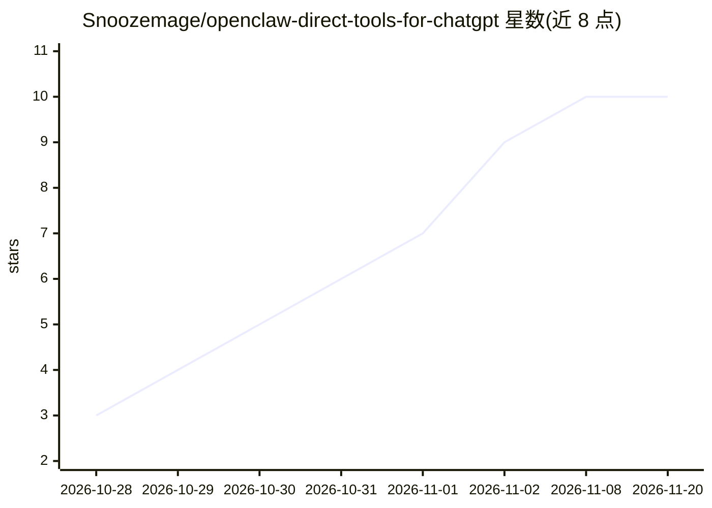

# Snoozemage/openclaw-direct-tools-for-chatgpt

⭐ 10 · JavaScript · MIT · 推送 2026-11-19 · [GitHub](https://github.com/Snoozemage/openclaw-direct-tools-for-chatgpt) · 个人维护

**让 ChatGPT 直接调用本地 OpenClaw 工具的 MCP 桥接器**

在本地运行 MCP 桥接服务，将 ChatGPT（自定义 MCP 连接器）接入 OpenClaw 运行时的工具集：浏览器自动化、Windows 桌面操作、本地文件读写与补丁、项目内文件/文本搜索、命令与进程控制、截图展示，以及动态发现并调度运行时中其他可用工具。调用经 OpenAI Secure MCP Tunnel 转发，桥接器不绕过 OpenClaw 的权限与审批策略；提供本地调用监控页、托盘状态组件与 Windows 开机自启（可选）。目前仅 Windows+PowerShell 路径经过验证。

## 筛选速览

| 维度 | 判定 | 备注 |
|---|---|---|
| AI 角色 | `ai-ecosystem` | LLM/agent 周边工具 |
| 许可风险 | `permissive` | MIT |
| 部署形态 | `desktop` | 安装包/桌面程序 |
| 模型依赖 | — | README 未给出锁定关系 |
| 硬件要求 | — | 无带数字的原话,不猜 |
| 安装摩擦 | `low` | 无编译、无系统依赖或容器化 |
| 成熟度 | — | 结构信号不足 |

## 能力要点

- 浏览器与 Windows 桌面自动化、文件读写与补丁、命令/进程控制等 MCP 工具集
- 动态工具发现三件套：搜索、描述 schema 并按 Gateway 路径调度运行时工具
- 不绕过 OpenClaw 权限、审批与策略；支持 ChatGPT Free
- 本地调用监控页（SSE 流式）与托盘健康状态组件

## 适用场景

- 在 ChatGPT 对话里让代理操作本地浏览器完成网页任务
- 让 ChatGPT 读写本地项目文件、跑命令与测试
- 在 Windows 桌面上用屏幕/鼠标/键盘自动化应用操作
- 发现并调用 OpenClaw 运行时里已安装的其他工具

## 场景标签

`浏览器自动化` `GUI 自动化` · 领域:效率与自动化

## 证据(README 行号)

> L5: Protocol: MCP
> L19: Rather than routing every operation through the OpenClaw Main Agent, ChatGPT can call the bridge's tools directly. 
> L68: The bridge provides the MCP endpoint, routes calls to feature-specific handlers, and hosts a local call monitor. De

## 星数曲线

2026-10-28 3 → 2026-11-20 10（+7）

---
*卡片 v1 · prompt 1.4 · 生成 2026-11-20 · 置信度 high · 依据 README sha `f971bd243818` · [字段定义](../../DATASET.md)*
