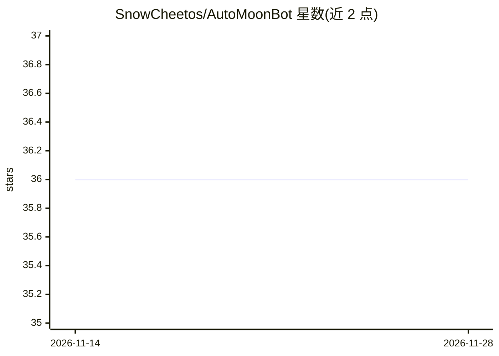

# SnowCheetos/AutoMoonBot

⭐ 36 · Python · MIT · 推送 2026-11-20 · [GitHub](https://github.com/SnowCheetos/AutoMoonBot) · 个人维护

**用异构图神经网络与强化学习做算法交易的实验性代码库**

面向量化交易研究者的个人项目，计划以异构图神经网络（基于 torch_geometric）与强化学习（含 policy gradient 的历史迭代）实现加密货币自动交易，思路受 Medallion Fund 公开方法论启发，强调利用多源公开数据与风险控制。README 明确声明内容仅供教育与信息目的，非金融产品或投资建议。项目处于早期未完成状态：Graphs、Installation、Quick Start 等章节均为占位文字，仅提供 pytest 测试流程与 legacy 目录中的旧实现。

## 筛选速览

| 维度 | 判定 | 备注 |
|---|---|---|
| AI 角色 | `ai-native` | 本体是模型或模型工具 |
| 许可风险 | `permissive` | MIT |
| 部署形态 | `library` | 以包/库形式分发 |
| 模型依赖 | — | README 未给出锁定关系 |
| 硬件要求 | — | 无带数字的原话,不猜 |
| 安装摩擦 | `low` | 无编译、无系统依赖或容器化 |
| 成熟度 | `idea` | |

## 能力要点

- 使用 torch_geometric 构建图神经网络
- 强化学习方法（actor-critic，主题标签声明）
- tests 目录提供 pytest 测试脚本
- legacy 目录保留 policy gradient 与经典集成两类旧实现

## 适用场景

- 研究图神经网络与强化学习在加密货币交易中的应用
- 参考 legacy 代码了解交易算法的迭代过程
- 作为教育与信息用途的算法交易实现参考

## 场景标签

`金融量化` `强化学习` · 领域:学习与行业

## 证据(README 行号)

> L1: This repository contains code and resources for automated algorithmic trading implementations. All content provided 
> L43: This project utilizes `torch_geometric` for Graph Neural Networks, I recommend visiting their site and install all 

## 星数曲线

2026-11-14 36 → 2026-11-28 36（+0）

---
*卡片 v1 · prompt 1.4 · 生成 2026-11-18 · 置信度 low · 依据 README sha `65ab1936b19f` · [字段定义](../../DATASET.md)*
