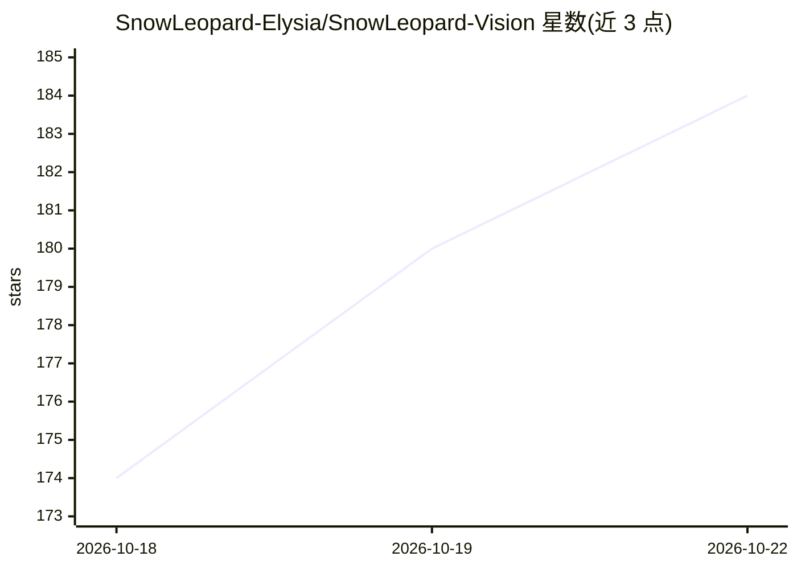

# SnowLeopard-Elysia/SnowLeopard-Vision

⭐ 186 · HTML · NOASSERTION · 推送 2026-10-22 · [GitHub](https://github.com/SnowLeopard-Elysia/SnowLeopard-Vision) · [官网](https://snowleopard-elysia.github.io/SnowLeopard-Vision/) · 个人维护 · 中文 README

**本地 AI 图片与视频增强工具：超分与补帧**

面向 Windows 用户（安装版/免安装版）的本地 AI 图像视频增强桌面工具，功能包括图片超分、视频超分、视频补帧及超分并补帧，支持队列任务、独立输出目录、字幕保留（含 MKV 样式字幕）与 NVIDIA GPU 占用显示。底层调用 FFmpeg、Real-ESRGAN、RIFE/rife-ncnn-vulkan、ncnn、Vulkan 等第三方能力。本仓库仅维护官网、说明与版本发布，不含源代码，功能免费使用，禁止未经许可收费销售或移除署名。

## 筛选速览

| 维度 | 判定 | 备注 |
|---|---|---|
| AI 角色 | `ai-native` | 本体是模型或模型工具 |
| 许可风险 | `none` | NOASSERTION |
| 部署形态 | `None` |  |
| 模型依赖 | — | README 未给出锁定关系 |
| 硬件要求 | — | 无带数字的原话,不猜 |
| 安装摩擦 | `medium` | 含编译或系统依赖之一 |
| 成熟度 | — | 结构信号不足 |

## 能力要点

- 图片超分、视频超分、视频补帧、超分并补帧四类增强功能
- 队列任务管理，每个任务可独立指定输出目录
- 字幕保留：兼容文本字幕转 MP4，MKV 输出可保留样式字幕与字体附件
- 调用 Real-ESRGAN、RIFE/rife-ncnn-vulkan、ncnn、Vulkan 等第三方能力

## 适用场景

- 给老照片或低分辨率图片做超分辨率增强
- 提升视频清晰度或补帧提高流畅度
- 批量处理队列任务并分别指定保存位置

## 场景标签

`图像视频处理` · 领域:感知与多模态

## 证据(README 行号)

> L10: SnowLeopard Vision 是一款本地 AI 图片与视频增强工具，支持图片超分、视频超分、视频补帧、超分并补帧。
> L43: 应用调用或依赖 FFmpeg、Real-ESRGAN、RIFE / rife-ncnn-vulkan、ncnn 和 Vulkan 等第三方能力，相关组件的版权与许可证归各自作者和项目所有。

## 星数曲线

2026-10-18 174 → 2026-10-22 184（+10）

---
*卡片 v1 · prompt 1.4 · 生成 2026-10-22 · 置信度 high · 依据 README sha `be67b14387c4` · [字段定义](../../DATASET.md)*
