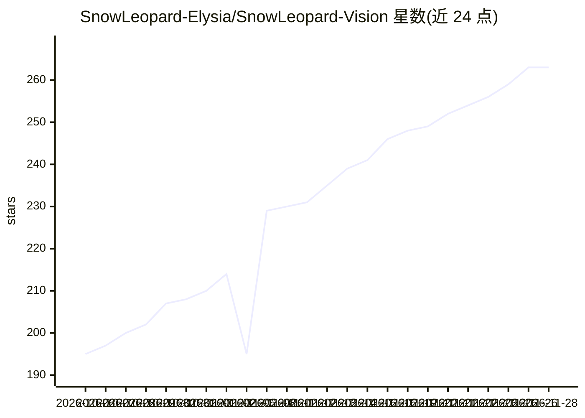

# SnowLeopard-Elysia/SnowLeopard-Vision

⭐ 263 · HTML · NOASSERTION · 推送 2026-11-21 · [GitHub](https://github.com/SnowLeopard-Elysia/SnowLeopard-Vision) · [官网](https://snowleopard-elysia.github.io/SnowLeopard-Vision/) · 个人维护 · 中文 README

**本地运行的图片视频超分补帧与音频处理工具**

本地 AI 图片、视频增强与音频工具，功能包括图片超分、视频超分、视频补帧、超分并补帧、音频格式转换和视频音频替换。V2.5 新增 Intel QSV 硬件编码，支持断点续跑、任务失败重试、固定帧率与转场保护补帧。Windows 平台提供安装版与免安装版，通过官网及夸克/迅雷/百度网盘和 GitHub Release 分发；仓库本身只维护官网与发布，不含应用源代码。应用调用 FFmpeg、Real-ESRGAN、RIFE/rife-ncnn-vulkan、ncnn、Vulkan 等第三方组件。

## 筛选速览

| 维度 | 判定 | 备注 |
|---|---|---|
| AI 角色 | `ai-native` | 本体是模型或模型工具 |
| 许可风险 | `none` | NOASSERTION |
| 部署形态 | `None` |  |
| 模型依赖 | — | README 未给出锁定关系 |
| 硬件要求 | — | 无带数字的原话,不猜 |
| 安装摩擦 | `medium` | 含编译或系统依赖之一 |
| 成熟度 | — | 结构信号不足 |

## 能力要点

- 图片/视频超分与视频补帧（Real-ESRGAN、RIFE 4.x）
- Intel QSV 硬件编码与断点续跑、失败重试
- 音频格式转换与视频音频替换
- 安装版与免安装版两种 Windows 分发形式

## 适用场景

- 批量给图片和视频做本地超分放大
- 给低帧率视频补帧提升流畅度
- 转换音频格式或替换视频音轨

## 场景标签

`图像视频处理` · 领域:感知与多模态

## 证据(README 行号)

> L10: SnowLeopard Vision 是一款本地 AI 图片、视频增强与音频工具，支持图片超分、视频超分、视频补帧、超分并补帧，以及音频格式转换和视频音频替换。
> L42: 应用调用或依赖 FFmpeg、Real-ESRGAN、RIFE / rife-ncnn-vulkan、ncnn 和 Vulkan 等第三方能力，相关组件的版权与许可证归各自作者和项目所有。

## 星数曲线

2026-10-26 195 → 2026-11-28 263（+68）

---
*卡片 v1 · prompt 1.4 · 生成 2026-11-25 · 置信度 high · 依据 README sha `68ff1709a0b5` · [字段定义](../../DATASET.md)*
