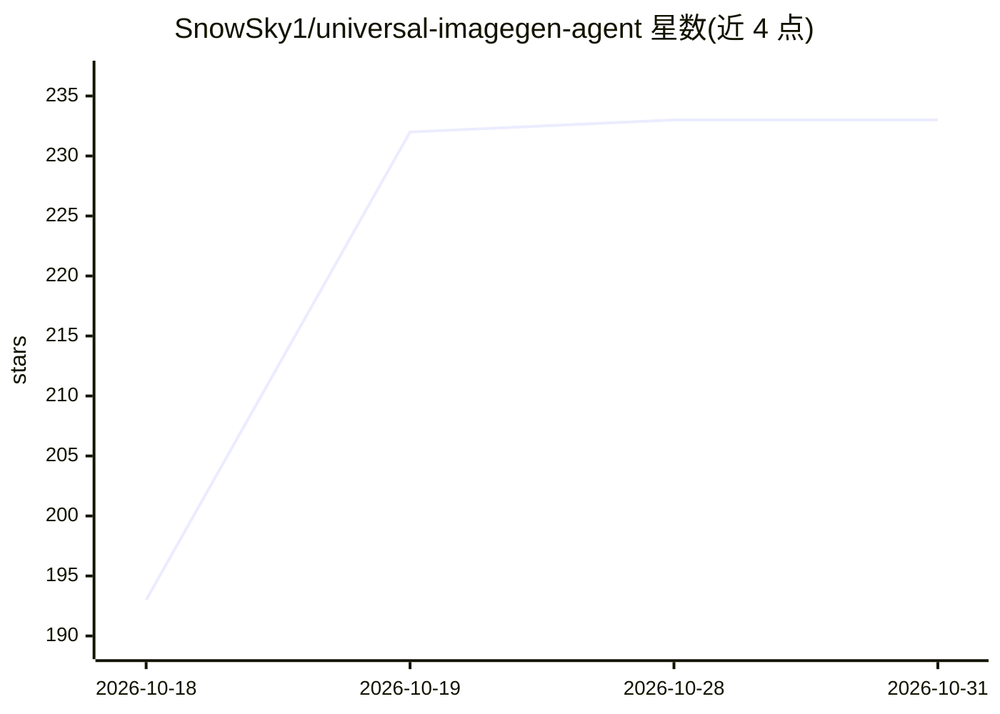

# SnowSky1/universal-imagegen-agent

⭐ 233 · Python · Apache-2.0 · 推送 2026-10-11 · [GitHub](https://github.com/SnowSky1/universal-imagegen-agent) · 个人维护 · 中文 README

**给任意智能体的生图 CLI/skill：复用 Codex 提示词工作流**

从 OpenAI Codex imagegen skill 改造的独立项目：把任务决策流程、提示词工程、用例分类、编辑不变量与提示词范例库抽离为通用能力，供具备 shell 或 Python 调用能力的智能体复用。提供 imagegen-agent CLI、Node.js/Python 接口、一键安装到 Codex 或兼容智能体的 skill，支持生成、编辑、多图输入、遮罩、JSONL 批处理与 --json 输出。内置 OpenAI-compatible Images API 适配层，可配置 base_url/模型接入第三方或 Qwen-Image 部署（本地 Diffusers/ComfyUI/SGLang 需经兼容网关或新增 adapter）。Apache 2.0。

## 筛选速览

| 维度 | 判定 | 备注 |
|---|---|---|
| AI 角色 | `ai-native` | 本体是模型或模型工具 |
| 许可风险 | `permissive` | Apache-2.0 |
| 部署形态 | `library` | 以包/库形式分发 |
| 模型依赖 | — | README 未给出锁定关系 |
| 硬件要求 | — | 无带数字的原话,不猜 |
| 安装摩擦 | `low` | 无编译、无系统依赖或容器化 |
| 成熟度 | — | 结构信号不足 |

## 能力要点

- CLI + Node.js/Python 接口 + 可安装 skill 三种接入形态
- 继承 Codex imagegen 的 use-case 分类、提示词范例与编辑不变量
- OpenAI-compatible Images API 适配层，base_url/模型/请求头可配置
- dry-run、--json 机器可读输出、稳定退出码、敏感配置脱敏

## 适用场景

- 让任意智能体通过统一 CLI 生成或编辑图片
- 把同一套生图工作流切换到 Qwen-Image 等开放模型后端
- 用 JSONL 批量生成图片资源

## 场景标签

`图像生成` · 领域:内容生成

## 证据(README 行号)

> L17: 这是一个从 OpenAI Codex `imagegen` skill 改造而来的、面向通用智能体的独立项目。它把 Codex 生图能力中已经沉淀下来的任务决策流程、提示词工程、用例分类、编辑不变量和提示词范例库抽离出来，使任意具
> L25: - 可由任意具备 shell 能力的智能体调用的 `imagegen-agent` CLI；

## 星数曲线

2026-10-18 193 → 2026-10-31 233（+40）

---
*卡片 v1 · prompt 1.4 · 生成 2026-10-22 · 置信度 high · 依据 README sha `90399bc78b6c` · [字段定义](../../DATASET.md)*
