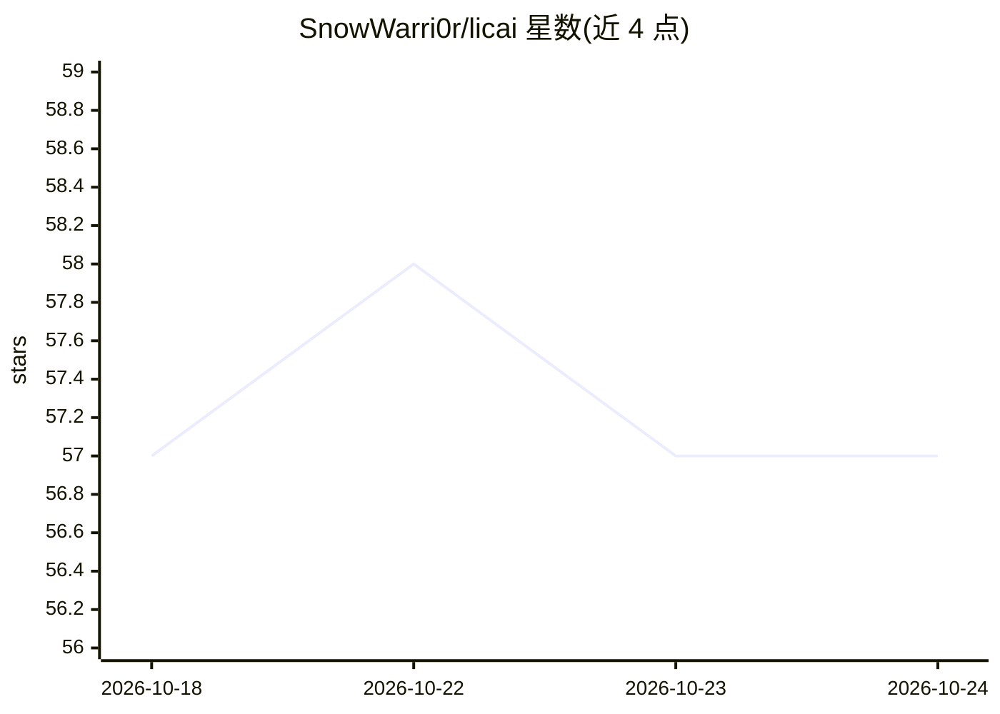

# SnowWarri0r/licai

⭐ 57 · Python · AGPL-3.0 · 推送 2026-10-22 · [GitHub](https://github.com/SnowWarri0r/licai) · 个人维护 · 中文 README

**本地化个人理财助手：全资产看板 + 市场AI问答**

面向国内个人投资者的本地部署理财工具：Python FastAPI + React + SQLite，PWA 形式，把 A股/基金/银行理财/现金/数字资产/量化机器人六类资产装进一个看板。核心模块包括挂 40 个数据工具的市场问答 agent（自行决定调用工具取数再客观解读）、个股K线/盘口详情、板块雷达、早盘LLM简报、资讯AI解读与复盘归因。声明只给客观信息不给买卖建议，无云端无账号，数据存本地 SQLite。Claude API、通达信数据源、知识星球等均为可选接入，不配时对应功能收敛或停用。

## 筛选速览

| 维度 | 判定 | 备注 |
|---|---|---|
| AI 角色 | `ai-enhanced` | 去掉 AI 部分产品仍成立 |
| 许可风险 | `viral` | AGPL-3.0 |
| 部署形态 | `library` | 以包/库形式分发 |
| 模型依赖 | — | README 未给出锁定关系 |
| 硬件要求 | — | 无带数字的原话,不猜 |
| 安装摩擦 | `low` | 无编译、无系统依赖或容器化 |
| 成熟度 | — | 结构信号不足 |

## 能力要点

- 六大类资产统一看板，含基金份额拆分自动入账与穿透同源检测
- 40 个数据工具的市场问答 agent，答案带可信度分级与来源角标
- provider/analyzer 插件协议，本仓库只定义接口不带实现
- 离线回归评测集 + 运行时自检 + 纠正沉淀规则的工具链

## 适用场景

- 把分散在各平台的理财头寸装进一个本地看板对账
- 用自然语言问个股、资金面、产业链等市场数据并得到带来源的回答
- 每日收盘后做组合复盘归因与买点回看

## 场景标签

`金融量化` `数据分析` · 领域:效率与自动化

## 证据(README 行号)

> L5: **把 A股 / 基金 / 银行理财 / 现金 / 数字资产 / 量化机器人 装进一个看板**
> L17: **只给客观信息，不给买卖建议。**
> L113: 不配也能用，只是早盘简报功能停用。
> L128: 启动日志出现 `TDX 数据源已启用: <地址>` 即接通。**不配也能用**——详情页会收敛成只有「日」一个页签，实时行情、日线、看板与榜单都不依赖它。

## 星数曲线

2026-10-18 57 → 2026-10-24 57（+0）

---
*卡片 v1 · prompt 1.4 · 生成 2026-10-24 · 置信度 mid · 依据 README sha `4ec2c132132b` · [字段定义](../../DATASET.md)*
