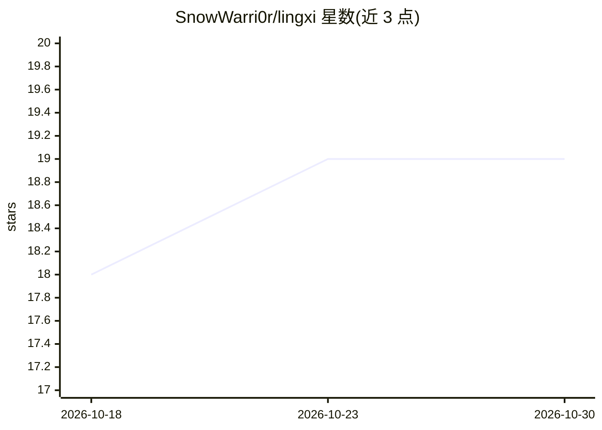

# SnowWarri0r/lingxi

⭐ 19 · Python · AGPL-3.0 · 推送 2026-10-27 · [GitHub](https://github.com/SnowWarri0r/lingxi) · 个人维护 · 中文 README

**有生活节奏与记忆的虚拟人格 agent，可自定义人设对话**

面向个人用户的虚拟人格 agent：以记忆流为唯一状态（Generative Agents 路线），后台每日排计划推进'生活'，能主动发消息、记住用户事实、感知时钟天气。编排用 Claude，中文说话用 DeepSeek/豆包单程生成。人设全在 YAML，支持飞书机器人、Web API、CLI 与桌面宠物入口。事实存 SQLite/FTS5/向量，提供行为回归评测与真人语料标注工具。AGPL-3.0-or-later。

## 筛选速览

| 维度 | 判定 | 备注 |
|---|---|---|
| AI 角色 | `ai-native` | 本体是模型或模型工具 |
| 许可风险 | `viral` | AGPL-3.0 |
| 部署形态 | `library` | 以包/库形式分发 |
| 模型依赖 | locked-api |  |
| 硬件要求 | — | 无带数字的原话,不猜 |
| 安装摩擦 | `low` | 无编译、无系统依赖或容器化 |
| 成熟度 | — | 结构信号不足 |

## 能力要点

- 记忆流为唯一状态，无情绪标量与状态机，照 Generative Agents 实现
- 编排（Claude）与说话（DeepSeek/豆包）分两个模型，说话程不挂工具
- 后台生活模拟：每日排计划、主动消息素材生成、查重与沉默感知
- 人设 YAML 独立数据，提供 lingxi-eval 行为回归与 lingxi-annotate 语料标注

## 适用场景

- 想要一个有记忆和日常生活的长期 AI 陪伴角色
- 在飞书里接一个会主动找你聊的机器人
- 按 YAML 定制不同人设和说话风格

## 场景标签

`聊天机器人` `Agent 记忆` · 领域:Agent 开发

## 证据(README 行号)

> L3: 一个可定制人设的虚拟人格 agent。目标是**真实的对话体验**——不是应答机器人，而是一个有自己的生活、记忆和主观理解的"人"。
> L10: - **记忆是唯一的状态。** 没有情绪标量、没有状态机。"她现在怎么样"就是她记忆流里最近发生的事——照 Generative Agents 那套做。
> L11: - **想事情和说话是两个模型。** 编排用 Claude，开口用中文母语模型单程生成。说话那一程不挂任何工具，语感不被打断。

## 星数曲线

2026-10-18 18 → 2026-10-30 19（+1）

---
*卡片 v1 · prompt 1.4 · 生成 2026-10-28 · 置信度 high · 依据 README sha `65e2fd1bd97c` · [字段定义](../../DATASET.md)*
