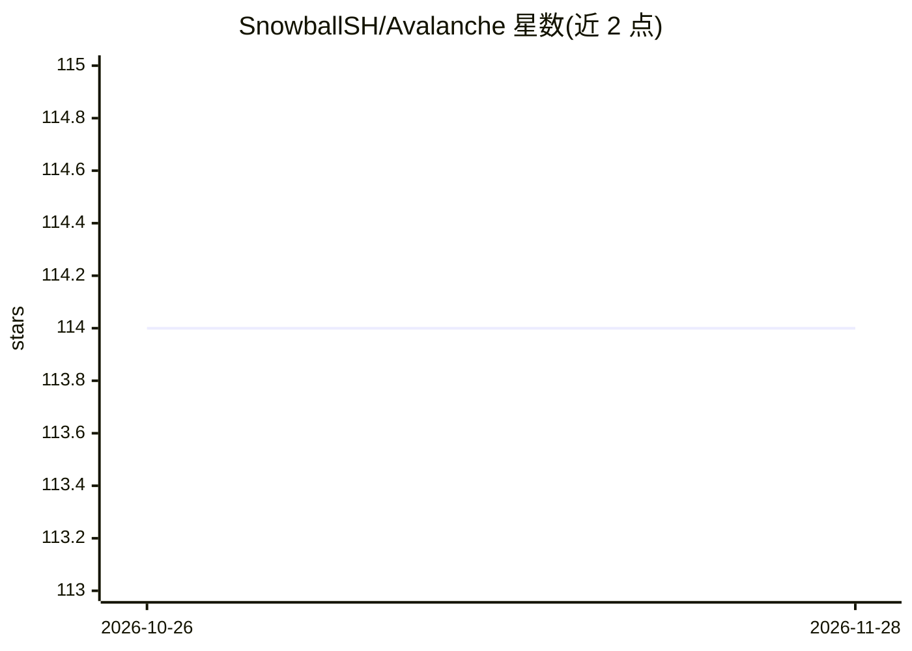

# SnowballSH/Avalanche

⭐ 114 · Zig · GPL-3.0 · 推送 2026-10-23 · [GitHub](https://github.com/SnowballSH/Avalanche) · [官网](https://avalanche.snowballsh.com) · 个人维护 · 中文 README

**Zig 编写的 UCI 国际象棋引擎，NNUE 评估**

Avalanche 是首个用 Zig 语言编写的 UCI 国际象棋引擎，评估采用 NNUE（高效可更新神经网络），网络全部通过自对弈强化学习训练生成。引擎遵循 UCI 协议，需配合 UCI 图形界面使用，支持 Chess960、Double Fischer Random、MultiPV、Syzygy 残局库、NUMA 感知线程池与等级限制等特性。构建仅需 Zig 0.17.0，无其他依赖，发布版按 CPU 指令集分级提供多个二进制及 wasm 模块。

## 筛选速览

| 维度 | 判定 | 备注 |
|---|---|---|
| AI 角色 | `ai-native` | 本体是模型或模型工具 |
| 许可风险 | `viral` | GPL-3.0 |
| 部署形态 | `None` |  |
| 模型依赖 | — | README 未给出锁定关系 |
| 硬件要求 | — | 无带数字的原话,不猜 |
| 安装摩擦 | `low` | 无编译、无系统依赖或容器化 |
| 成熟度 | — | 结构信号不足 |

## 能力要点

- 首个以 Zig 语言编写并发布的国际象棋引擎，无外部依赖
- NNUE 评估网络通过自对弈强化学习训练（多代网络迭代）
- 支持 Chess960、MultiPV、Syzygy 残局库、 pondering、UCI_Elo 等级限制
- 发布二进制按 CPU 指令集（v1–avx512、ARM dotprod）分级并提供 wasm 模块

## 适用场景

- 接入 UCI 图形界面进行人机或引擎对弈
- 在国际象棋服务器（如 lichess）上运行引擎账号
- 研究 NNUE 训练与自对弈数据生成流程

## 场景标签

 · 领域:游戏/棋类 AI

## 证据(README 行号)

> L5: Avalanche is a strong UCI chess engine written in Zig.
> L23: Avalanche was one of the earliest adopters of the **NNUE** (Efficiently Updatable Neural Network) technology for it
> L71: Avalanche follows the UCI protocol and is not a full chess application. You should use Avalanche with a UCI-compati

## 星数曲线

2026-10-26 114 → 2026-11-28 114（+0）

---
*卡片 v1 · prompt 1.4 · 生成 2026-11-28 · 置信度 high · 依据 README sha `991bc6af9f15` · [字段定义](../../DATASET.md)*
