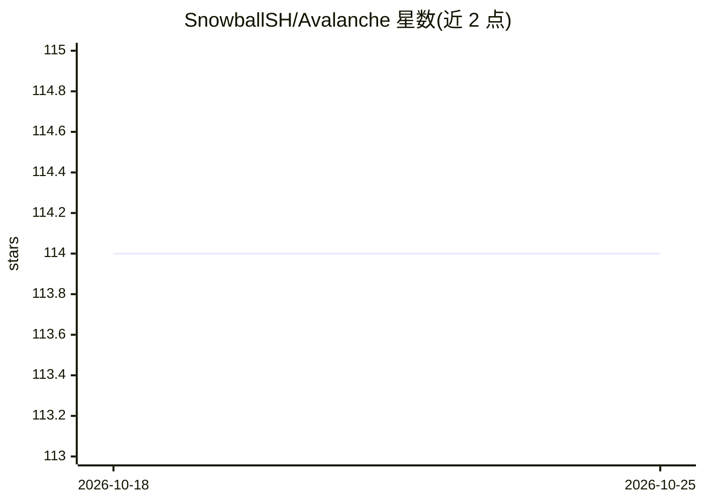

# SnowballSH/Avalanche

⭐ 114 · Zig · GPL-3.0 · 推送 2026-10-23 · [GitHub](https://github.com/SnowballSH/Avalanche) · [官网](https://avalanche.snowballsh.com) · 个人维护 · 中文 README

**Zig 编写的 UCI 国际象棋引擎，内置 NNUE 评估**

用 Zig 实现的 UCI 协议国际象棋引擎，作者 Yinuo Huang (SnowballSH)。评估采用 NNUE（Efficiently Updatable Neural Network），全部网络通过自我对弈强化学习训练，README 列出 14 代网络代号及架构；残局保留 PeSTO 手工评估用于对付孤王。搜索、走子生成等代码为手写。支持 Chess960、Syzygy 残局库、NUMA 线程池、MultiPV 等。仅提供 UCI 引擎本体，需配合 UCI 兼容 GUI 使用；无外部依赖，通过 zig build 从源码编译，并提供多 CPU 特性级别的发布二进制。

## 筛选速览

| 维度 | 判定 | 备注 |
|---|---|---|
| AI 角色 | `ai-native` | 本体是模型或模型工具 |
| 许可风险 | `viral` | GPL-3.0 |
| 部署形态 | `None` |  |
| 模型依赖 | — | README 未给出锁定关系 |
| 硬件要求 | — | 无带数字的原话,不猜 |
| 安装摩擦 | `low` | 无编译、无系统依赖或容器化 |
| 成熟度 | `idea` | |

## 能力要点

- 自称首个用 Zig 编写并发布的国际象棋引擎，零外部依赖
- NNUE 评估，14 代网络均由自我对弈强化学习训练
- 支持 Chess960、Syzygy 表库、MultiPV、NUMA 感知线程池、UCI_LimitStrength 限强度
- 按 CPU 特性（v1 至 avx512、aarch64/dotprod）发布多档二进制

## 适用场景

- 配合 UCI 兼容 GUI 下棋或分析局面
- 参加计算机象棋竞赛（TCEC/CCRL 榜单测试）
- 研究 NNUE 架构与自我对弈训练流程（docs/NNUE.md、DATAGEN.md）

## 场景标签

 · 领域:游戏/博弈引擎

## 证据(README 行号)

> L23: Avalanche was one of the earliest adopters of the **NNUE** (Efficiently Updatable Neural Network) technology for it
> L73: Supported features include Chess960 and Double Fischer Random Chess, pondering, MultiPV, `searchmoves`, `go mate`, 

## 星数曲线

2026-10-18 114 → 2026-10-25 114（+0）

---
*卡片 v1 · prompt 1.4 · 生成 2026-10-23 · 置信度 high · 依据 README sha `a063a9bf059d` · [字段定义](../../DATASET.md)*
