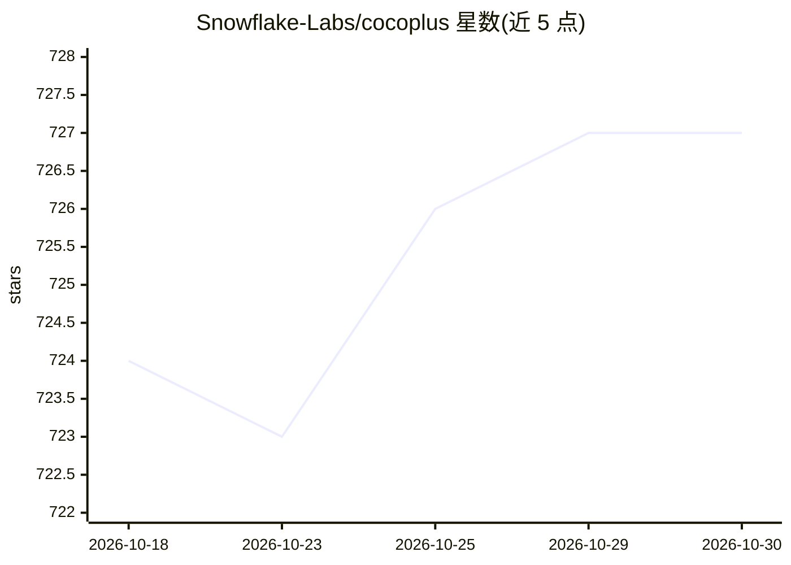

# Snowflake-Labs/cocoplus

⭐ 727 · JavaScript · MIT · 推送 2026-10-04 · [GitHub](https://github.com/Snowflake-Labs/cocoplus) · [官网](https://cocoplus.dev/) · 组织维护

**面向 Snowflake Coco 的数据工程多智能体工作流插件系统**

以 Coco 插件形式提供的 Agentic Operating System，为数据工程项目套上结构化生命周期：从 spec、plan、build、test、review 到 ship 阶段，用阶段门控、并行专家角色（8 种数据角色 persona）与检查点校验组织多智能体协作。包含只读浏览器控制台 CocoConsole、自然语言编排 CocoPilot、目标驱动专家团队 CocoForge、治理钩子（PII、ReviewerLockout）、运行时策略引擎（allow/deny/instruct 模型拦截危险 Snowflake 操作）、会话连续性与记忆蒸馏等机制。需要 Snowflake Coco CLI（cortex）与 Node.js，通过 cortex plugin install 安装，MIT 许可。

## 筛选速览

| 维度 | 判定 | 备注 |
|---|---|---|
| AI 角色 | `ai-ecosystem` | LLM/agent 周边工具 |
| 许可风险 | `permissive` | MIT |
| 部署形态 | `None` |  |
| 模型依赖 | — | README 未给出锁定关系 |
| 硬件要求 | — | 无带数字的原话,不猜 |
| 安装摩擦 | `low` | 无编译、无系统依赖或容器化 |
| 成熟度 | — | 结构信号不足 |

## 能力要点

- 阶段门控式开发生命周期：spec→plan→build→test→review→ship
- 8 种专家 persona（$de/$ae/$ds/$da/$bi/$dpm/$dst/$cdo）并行执行
- 运行时策略引擎拦截 DROP TABLE、无 WHERE 的 DELETE 等危险操作
- CocoConsole 只读浏览器控制台展示 Flow、成本、会话与策略决策日志

## 适用场景

- 在 Snowflake 数据工程项目中用多智能体分工完成从需求到交付的流程
- 为生产 Snowflake 操作配置治理策略与审计日志
- 跨会话延续长周期数据工程任务的进度与决策记录

## 场景标签

`多智能体` · 领域:Agent 开发

## 证据(README 行号)

> L5: **CocoPlus** is an Agentic Operating System for Snowflake Coco. It brings structured, multi-agent workflows to data 
> L7: Built using only Coco-native constructs: Skills, Agents, Hooks, and AGENTS.md.
> L11: CocoPlus wraps a structured development lifecycle around every project — from requirements capture through producti

## 星数曲线

2026-10-18 724 → 2026-10-30 727（+3）

---
*卡片 v1 · prompt 1.4 · 生成 2026-10-22 · 置信度 high · 依据 README sha `c80a9d7da5c1` · [字段定义](../../DATASET.md)*
