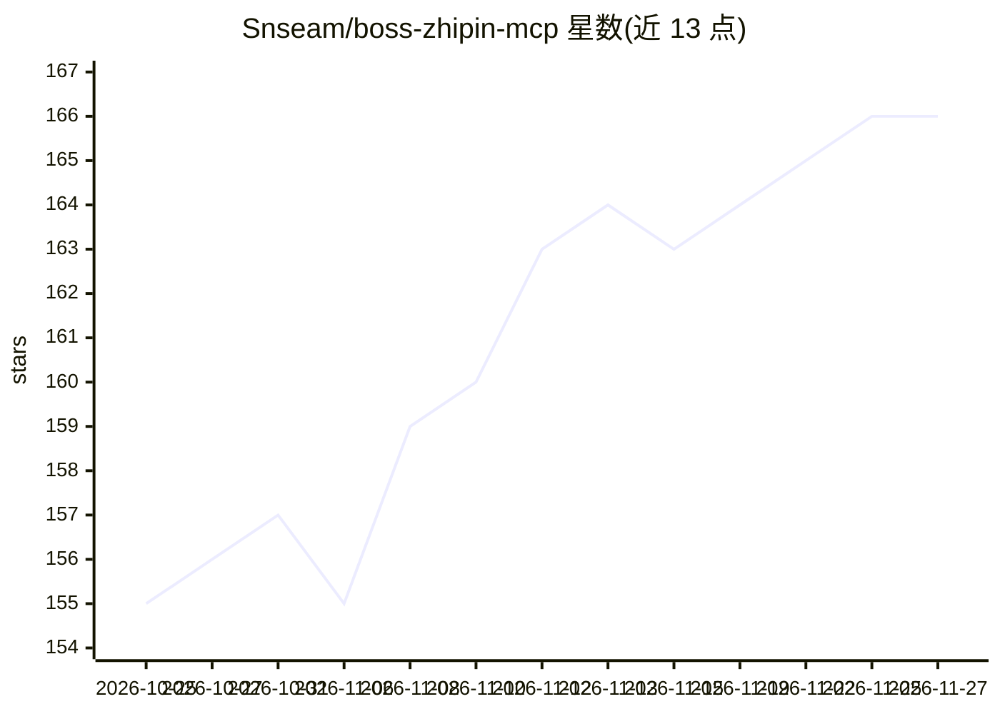

# Snseam/boss-zhipin-mcp

⭐ 166 · Python · 推送 2026-11-26 · [GitHub](https://github.com/Snseam/boss-zhipin-mcp) · 个人维护 · 中文 README

**给招聘者的 BOSS 直聘自动化 MCP Server，供 Claude 调用**

基于 Model Context Protocol（FastMCP）的 BOSS 直聘招聘者端自动化工具，通过 Playwright/CDP 连接已登录的 Chrome，在 SPA 页面内执行搜索、查看、打招呼等操作。提供 14 个 MCP 工具：多关键词批量搜索（12+ 关键词轮询、去重）、Canvas 简历截图与 QR 解码获取分享链接、YAML 条件筛选评分、本地 JSON 数据库持久化与中断恢复、Markdown 报告导出。需用户登录招聘者账号；评估环节建议由 Claude 在对话中完成。

## 筛选速览

| 维度 | 判定 | 备注 |
|---|---|---|
| AI 角色 | `ai-ecosystem` | LLM/agent 周边工具 |
| 许可风险 | `none` | — |
| 部署形态 | `desktop` | 安装包/桌面程序 |
| 模型依赖 | locked-api |  |
| 硬件要求 | — | 无带数字的原话,不猜 |
| 安装摩擦 | `low` | 无编译、无系统依赖或容器化 |
| 成熟度 | — | 结构信号不足 |

## 能力要点

- 14 个 MCP 工具覆盖搜索/查看/打招呼/筛选/报告流程
- 多关键词批量搜索自动去重并自动提取 zpurl.cn 分享链接
- Canvas 简历截图 + QR 解码绕过防爬，候选数据 JSON 持久化支持中断恢复
- YAML 配置岗位、关键词与筛选条件，支持随机延迟反检测

## 适用场景

- 批量搜索并筛选 BOSS 直聘候选人并导出 Markdown 报告
- 自动化提取候选人简历分享链接便于团队传阅
- 对候选人按年龄/薪资/状态等条件打分排序

## 场景标签

`浏览器自动化` · 领域:效率与自动化

## 证据(README 行号)

> L9: **BOSS 直聘 (zhipin.com)** 招聘者端自动化工具，基于 Model Context Protocol (MCP)，让 Claude Code / Claude Desktop 等 AI 助手直接操作 BOSS 直
> L33: 通过 Playwright 连接你已登录的 Chrome 浏览器，在 BOSS 直聘的 SPA 页面内操作搜索、查看、发消息等功能。

## 星数曲线

2026-10-25 155 → 2026-11-27 166（+11）

---
*卡片 v1 · prompt 1.4 · 生成 2026-11-27 · 置信度 high · 依据 README sha `d74bfd744834` · [字段定义](../../DATASET.md)*
