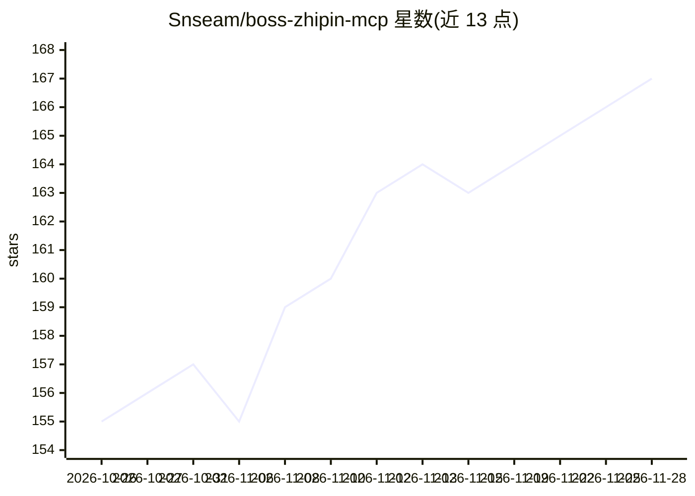

# Snseam/boss-zhipin-mcp

⭐ 167 · Python · 推送 2026-11-27 · [GitHub](https://github.com/Snseam/boss-zhipin-mcp) · 个人维护 · 中文 README

**BOSS直聘招聘者端 MCP Server：让 AI 客户端自动化招聘流程**

基于 Model Context Protocol 的 BOSS 直聘招聘者端自动化工具，通过 Playwright 经 CDP 连接已登录的 Chrome，在招聘后台 SPA 页面内执行搜索、查看简历、提取分享链接、打招呼等操作。提供 16 个 MCP 工具：多关键词批量搜索（12+ 关键词轮询去重）、Canvas 简历截图与 QR 解码、YAML 条件筛选评分、本地 JSON 数据库持久化与中断恢复、Markdown 报告导出。需 Chrome 与招聘者账号，配置后由 MCP 桌面客户端调用。

## 筛选速览

| 维度 | 判定 | 备注 |
|---|---|---|
| AI 角色 | `ai-ecosystem` | LLM/agent 周边工具 |
| 许可风险 | `none` | — |
| 部署形态 | `desktop` | 安装包/桌面程序 |
| 模型依赖 | — | README 未给出锁定关系 |
| 硬件要求 | — | 无带数字的原话,不猜 |
| 安装摩擦 | `low` | 无编译、无系统依赖或容器化 |
| 成熟度 | — | 结构信号不足 |

## 能力要点

- 16 个 MCP 工具覆盖搜索、看简历、打招呼、筛选评分、导出报告全流程
- 多关键词批量搜索：12+ 关键词轮询、跨关键词去重、自动获取 zpurl.cn 分享链接
- Canvas 渲染简历通过截图 + QR 码解码绕过文字提取限制
- JSON 数据库原子写入，任意步骤中断后可查看进度并恢复

## 适用场景

- 批量搜索并筛选北京 AI 产品经理等岗位候选人
- 让 Claude 对话式地查看简历、评估并标记候选人
- 一键导出含跟进表的 Markdown 候选人报告

## 场景标签

`浏览器自动化` · 领域:效率与自动化

## 证据(README 行号)

> L9: **BOSS 直聘 (zhipin.com)** 招聘者端自动化工具，基于 Model Context Protocol (MCP)，让 Claude Code、Claude Desktop、WorkBuddy、Cursor、VS 
> L29: boss-zhipin-mcp (FastMCP Server)

## 星数曲线

2026-10-26 155 → 2026-11-28 167（+12）

---
*卡片 v1 · prompt 1.4 · 生成 2026-11-28 · 置信度 mid · 依据 README sha `a7091b18e600` · [字段定义](../../DATASET.md)*
