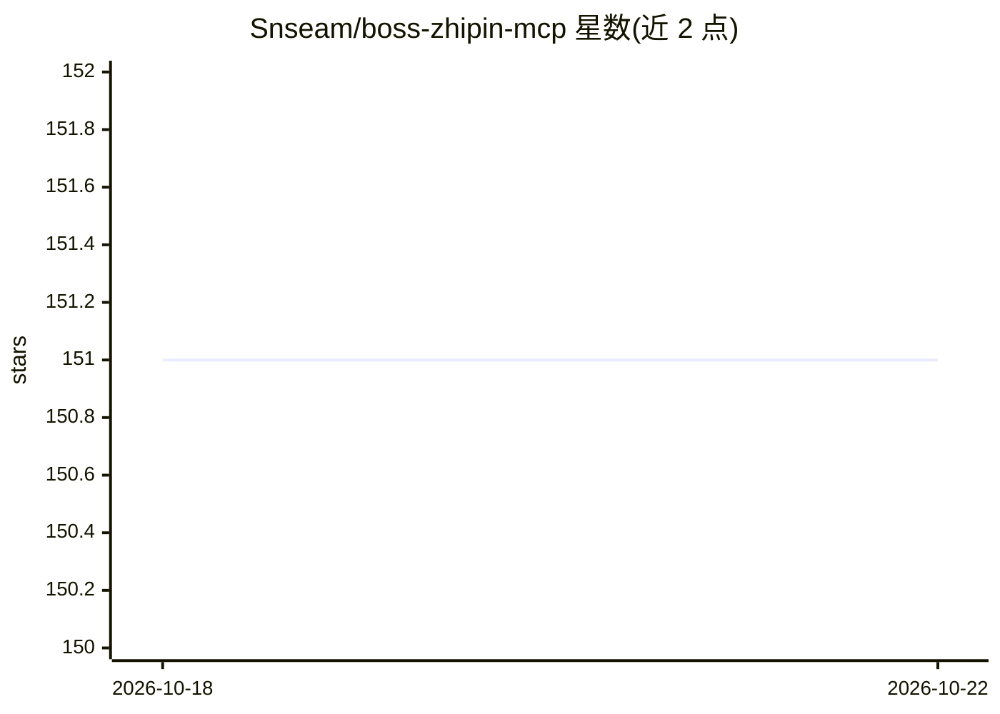

# Snseam/boss-zhipin-mcp

⭐ 153 · Python · 推送 2026-03-31 · [GitHub](https://github.com/Snseam/boss-zhipin-mcp) · 个人维护 · 中文 README

**让 AI 助手自动化操作 BOSS 直聘招聘后台的 MCP Server**

面向 BOSS 直聘招聘者的 MCP Server：通过 Playwright/CDP 连接已登录的 Chrome，在招聘后台 SPA 页面内执行候选人搜索、简历截图、分享链接提取、打招呼等操作。提供 16 个 MCP 工具，含多关键词批量搜索（自动去重）、本地 JSON 候选人数据库（中断可恢复）、按 YAML 条件筛选评分与 Markdown 报告导出。需配合 Claude Code / Claude Desktop 使用，依赖招聘者账号登录。简历以 Canvas 渲染，需截图后由 AI 看图识别。

## 筛选速览

| 维度 | 判定 | 备注 |
|---|---|---|
| AI 角色 | `ai-ecosystem` | LLM/agent 周边工具 |
| 许可风险 | `none` | — |
| 部署形态 | `library` | 以包/库形式分发 |
| 模型依赖 | — | README 未给出锁定关系 |
| 硬件要求 | — | 无带数字的原话,不猜 |
| 安装摩擦 | `low` | 无编译、无系统依赖或容器化 |
| 成熟度 | — | 结构信号不足 |

## 能力要点

- 12+ 关键词批量搜索，跨关键词去重与自动获取 zpurl.cn 分享链接
- 候选人结果持久化到本地 JSON 数据库，支持中断恢复与状态流转
- 按 YAML 条件（年龄/薪资/状态）筛选 + 多维度评分，一键导出 Markdown 报告
- 16 个 MCP 工具，覆盖搜索、查看、打招呼、数据库查询与调试

## 适用场景

- 我是招聘者，想批量搜索候选人并自动整理成报告
- 我想让 Claude 在 BOSS 直聘后台代为查看简历并发起沟通
- 我想按自定义条件对候选人自动筛选评分并跟踪状态

## 场景标签

`浏览器自动化` · 领域:效率与自动化

## 证据(README 行号)

> L9: **BOSS 直聘 (zhipin.com)** 招聘者端自动化工具，基于 Model Context Protocol (MCP)，让 Claude Code / Claude Desktop 等 AI 助手直接操作 BOSS 直
> L29: boss-zhipin-mcp (FastMCP Server)

## 星数曲线

2026-10-18 151 → 2026-10-22 151（+0）

---
*卡片 v1 · prompt 1.4 · 生成 2026-10-22 · 置信度 mid · 依据 README sha `6f5fc17ed5b2` · [字段定义](../../DATASET.md)*
