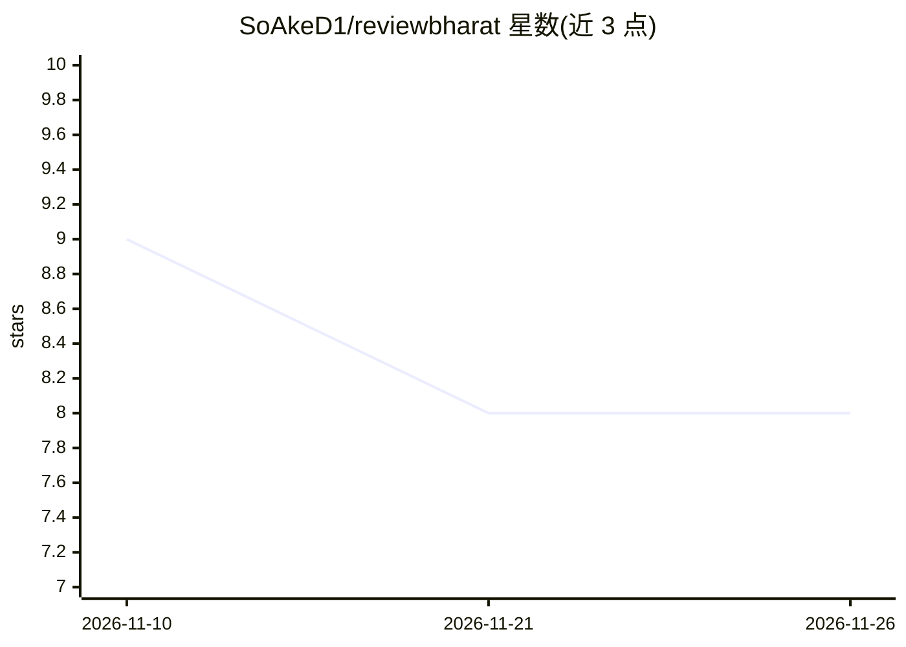

# SoAkeD1/reviewbharat

⭐ 8 · JavaScript · MIT · 推送 2026-11-09 · [GitHub](https://github.com/SoAkeD1/reviewbharat) · 个人维护

**开发者 PR 代码审查工具：英/印地/Hinglish 三语 AI 评审**

面向学生与小团队的 GitHub PR 审查工具：读取 PR 链接、diff 文件或管道 git diff，调用 BharatCode API（默认 Qwen 3.8 27B）生成按严重度排序的 bug 与安全问题清单，附文件、行号与可粘贴修复。支持 GitHub Action、CLI、pre-commit hook 与本地 Web UI 四种使用方式。无 key 时退化为离线模式匹配检查（密钥泄漏、SQL 注入等）。Node 20+，零依赖，MIT 许可。

## 筛选速览

| 维度 | 判定 | 备注 |
|---|---|---|
| AI 角色 | `ai-native` | 本体是模型或模型工具 |
| 许可风险 | `permissive` | MIT |
| 部署形态 | `None` |  |
| 模型依赖 | — | README 未给出锁定关系 |
| 硬件要求 | — | 无带数字的原话,不猜 |
| 安装摩擦 | `low` | 无编译、无系统依赖或容器化 |
| 成熟度 | — | 结构信号不足 |

## 能力要点

- 英/印地/Hinglish 三语解释每个发现并附修复代码
- GitHub Action / CLI / pre-commit hook / Web UI 四种接入方式
- 无 API key 的离线 demo 模式（模式匹配检查）
- 大 diff 切分、API 限流重试与混乱模型输出恢复

## 适用场景

- 给每个 PR 自动生成带行号的 bug 与安全问题清单
- 在 pre-commit 阶段拦截含严重问题的提交
- 团队偏好印地语或 Hinglish 阅读审查意见

## 场景标签

`代码审查` · 领域:编码与开发

## 证据(README 行号)

> L3: **AI code review for every pull request, in English, Hinglish or Hindi.**
> L81: |**Any provider**|BharatCode by default; Groq, Gemini, OpenRouter or your own OpenAI-compatible server.|

## 星数曲线

2026-11-10 9 → 2026-11-26 8（-1）

---
*卡片 v1 · prompt 1.4 · 生成 2026-11-20 · 置信度 high · 依据 README sha `78e5f04c94b2` · [字段定义](../../DATASET.md)*
