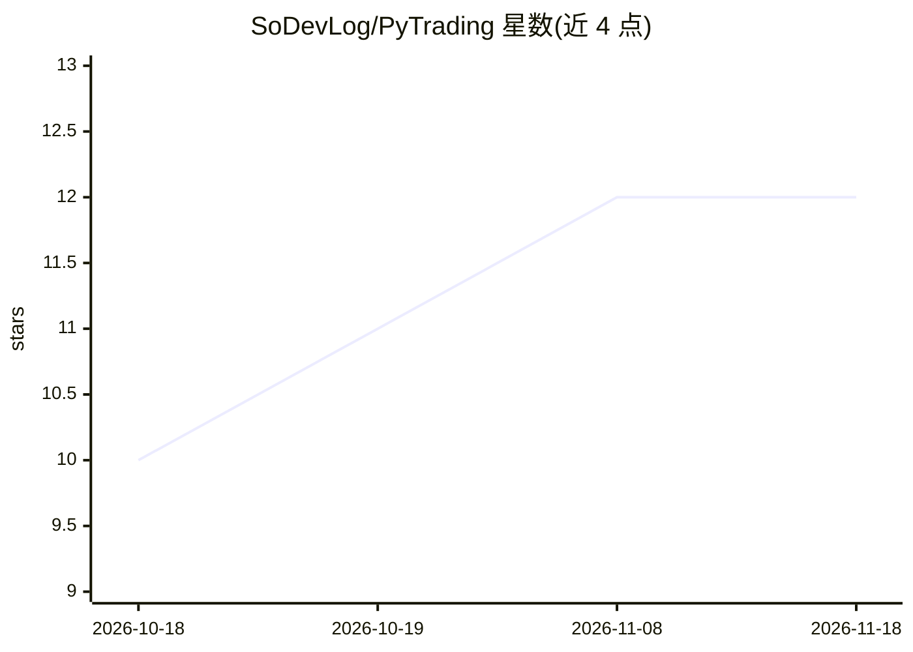

# SoDevLog/PyTrading

⭐ 12 · Python · 推送 2026-11-17 · [GitHub](https://github.com/SoDevLog/PyTrading) · [官网](https://www.trading-et-data-analyses.com/) · 个人维护

**给交易者的 Python 技术分析与回测平台，含 AI 价格预测**

面向交易者的 Python 量化交易平台：提供多周期图表、十余种技术指标（MACD/RSI/布林带/Ichimoku 等）、策略回测、SMC 机构信号检测、邮件价格与成交量警报、持仓组合管理。AI 部分包括基于 Keras/TensorFlow 与 Jax 的神经网络价格预测及 Kalman 滤波趋势预测，并可调用 scikit-learn。Windows 提供独立可执行文件与安装包，算法源码公开可扩展，提供策略 API 与脚本执行器；试用后付费策略需购买许可。

## 筛选速览

| 维度 | 判定 | 备注 |
|---|---|---|
| AI 角色 | `ai-enhanced` | 去掉 AI 部分产品仍成立 |
| 许可风险 | `none` | — |
| 部署形态 | `desktop` | 安装包/桌面程序 |
| 模型依赖 | — | README 未给出锁定关系 |
| 硬件要求 | — | 无带数字的原话,不猜 |
| 安装摩擦 | `low` | 无编译、无系统依赖或容器化 |
| 成熟度 | — | 结构信号不足 |

## 能力要点

- 基于 Keras/TensorFlow、Jax、scikit-learn 的价格预测与 Kalman 滤波趋势预测
- 多周期分析与十余种内置技术指标，支持实时回测
- 算法源码公开，提供策略 API 与脚本执行器（Script runner）
- Windows 提供免安装独立可执行文件与安装包

## 适用场景

- 对股票做技术分析与多策略回测
- 用神经网络/Kalman 滤波做价格趋势预测
- 通过邮件接收价格与成交量警报并跟踪持仓
- 用策略 API 编写自己的交易策略

## 场景标签

`金融量化` · 领域:学习与行业

## 证据(README 行号)

> L28: - **Artificial Intelligence** - price prediction using Keras/TensorFlow and Kalman filter
> L35: TradingInPython is not intended to be a clone of TradingView. It takes a different approach: giving traders the pow
> L236: - On Windows 7 you can try but most of the time you'll get error, so you need a **Windows more than 7**.

## 星数曲线

2026-10-18 10 → 2026-11-18 12（+2）

---
*卡片 v1 · prompt 1.4 · 生成 2026-11-18 · 置信度 high · 依据 README sha `fb414b1e76ad` · [字段定义](../../DATASET.md)*
