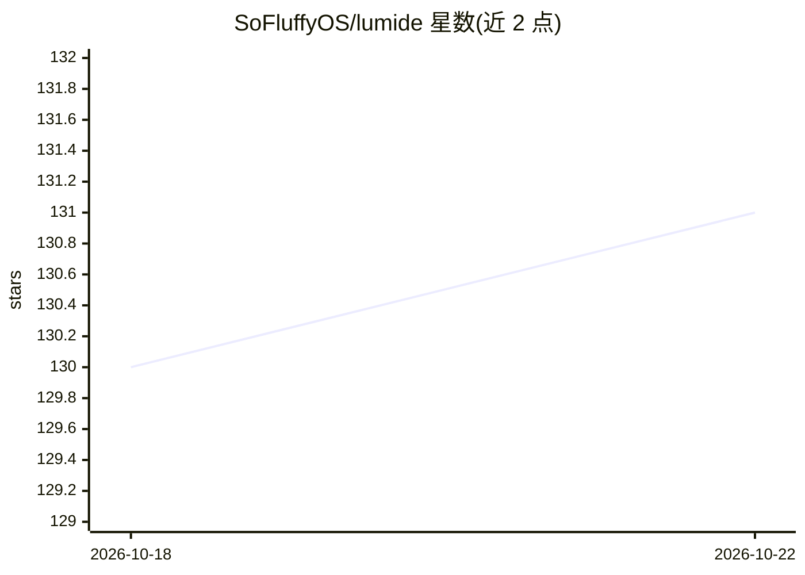

# SoFluffyOS/lumide

⭐ 139 · 推送 2026-10-21 · [GitHub](https://github.com/SoFluffyOS/lumide) · [官网](https://lumide.dev) · 组织维护

**Flutter 构建的桌面代码编辑器，内置 AI agent 接入**

基于 Flutter 构建的桌面优先 IDE，采用 GPU 加速渲染管线，编辑器与终端目标 120 FPS，自定义 Rope 数据结构文本渲染引擎，冷启动低于 200ms，空闲内存约 80MB。AI 相关功能包括行内建议与 Ghost Text 体验、通过 Agent Client Protocol (ACP) 集成 AI agent 并提供原生 ACP agent 托管。另含 C.O.R.G.I. Git 客户端、LSP 语言支持（针对 Dart/Flutter 优化）、可定制键位与停靠式工作区。提供 macOS/Windows/Linux 安装包，本仓库托管发布与问题跟踪。

## 筛选速览

| 维度 | 判定 | 备注 |
|---|---|---|
| AI 角色 | `ai-enhanced` | 去掉 AI 部分产品仍成立 |
| 许可风险 | `none` | — |
| 部署形态 | `desktop` | 安装包/桌面程序 |
| 模型依赖 | — | README 未给出锁定关系 |
| 硬件要求 | — | 无带数字的原话,不猜 |
| 安装摩擦 | `low` | 无编译、无系统依赖或容器化 |
| 成熟度 | — | 结构信号不足 |

## 能力要点

- Agent Client Protocol (ACP) 集成与原生 ACP agent 托管
- 行内建议与 Ghost Text AI 补全体验
- Rope 数据结构自定义文本渲染引擎，冷启动低于 200ms
- C.O.R.G.I. Git 客户端（Split-Brain 布局、粒度化暂存）

## 适用场景

- 在桌面端编写代码并获得 AI 行内补全
- 在 IDE 内托管和连接 ACP 协议的 AI agent
- 使用针对 Dart/Flutter 优化的轻量编辑器进行开发

## 场景标签

`代码生成` · 领域:编码与开发

## 证据(README 行号)

> L5: **Lumide** is an IDE built with **Flutter**. It features a GPU-accelerated architecture and first-class support for 
> L19: * **🕵️ Agent-Native Architecture**: Integration for AI agents using the **Agent Client Protocol (ACP)**. Features n

## 星数曲线

2026-10-18 130 → 2026-10-22 131（+1）

---
*卡片 v1 · prompt 1.4 · 生成 2026-10-22 · 置信度 high · 依据 README sha `1b7fa9bf002a` · [字段定义](../../DATASET.md)*
