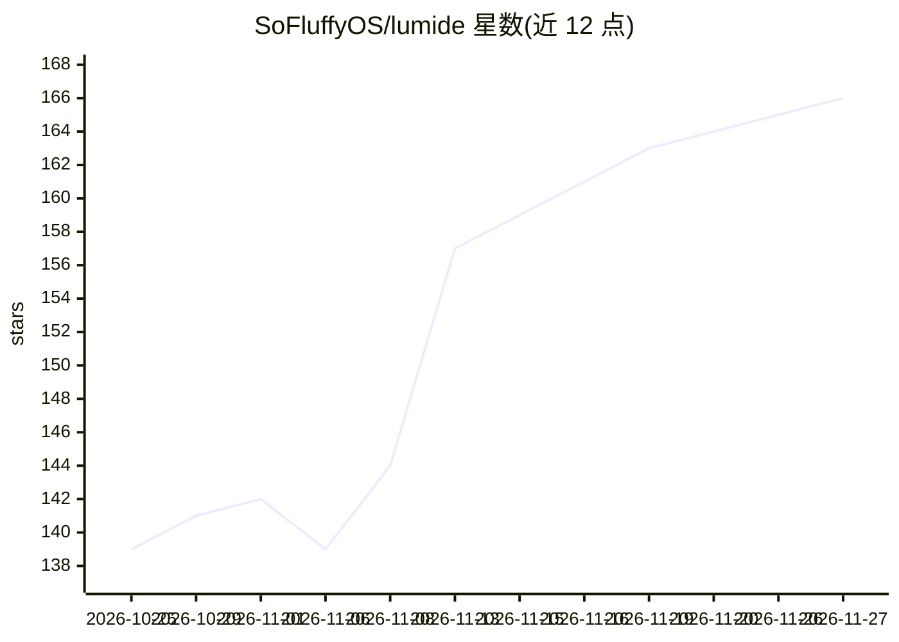

# SoFluffyOS/lumide

⭐ 166 · 推送 2026-11-22 · [GitHub](https://github.com/SoFluffyOS/lumide) · [官网](https://lumide.dev) · 个人维护

**Flutter 原生桌面代码编辑器，内置 ACP Agent 协作**

用 Flutter/Dart 编写的 macOS/Windows/Linux 桌面 IDE，AOT 编译为机器码并由 GPU 渲染，不依赖 Electron 或浏览器引擎。编辑器提供多光标、LSP 语言支持、JetBrains/VS Code/Sublime 键位与 Vim 模式、内置 Git 客户端（C.O.R.G.I.）、画布式面板布局（O.W.L.）、远程 SSH、工作区共享及 Flutter/Dart 运行调试。Agent 相关机制：通过 Agent Client Protocol 运行 Claude、GitHub Copilot、OpenCode 等 agent，逐文件审查改动、回退到任意时点，并提供 ghost text 补全。源码未公开，本仓库承载发布与 issue 跟踪。

## 筛选速览

| 维度 | 判定 | 备注 |
|---|---|---|
| AI 角色 | `ai-enhanced` | 去掉 AI 部分产品仍成立 |
| 许可风险 | `none` | — |
| 部署形态 | `desktop` | 安装包/桌面程序 |
| 模型依赖 | — | README 未给出锁定关系 |
| 硬件要求 | — | 无带数字的原话,不猜 |
| 安装摩擦 | `low` | 无编译、无系统依赖或容器化 |
| 成熟度 | — | 结构信号不足 |

## 能力要点

- 通过 ACP 运行任意 agent，逐文件审查改动并支持任意时点回退
- Dart AOT 编译为 ARM64/x64 机器码，Flutter GPU 渲染，无浏览器内核
- 内置 Git 图形客户端、协作共享工作区与远程 SSH
- 支持 40+ 语言的 LSP 与 pub.dev 插件生态

## 适用场景

- 在桌面 IDE 中运行 Claude/Copilot 等 agent 并审查其代码改动
- 管理 Flutter/Dart 项目的运行、热重载与断点调试
- 通过链接与他人共享工作区、终端与 Agent Chat
- 用画布式面板组织多文件与运行中的应用窗口

## 场景标签

`编码 Agent` `AI 助手` · 领域:编码与开发

## 证据(README 行号)

> L7:  An IDE in pure Flutter and Dart, for macOS, Windows and Linux.
> L23: - 🤖 **Agent-native.** Run Claude, GitHub Copilot, OpenCode or any agent that speaks the Agent Client Protocol, and 
> L138: This repository holds Lumide's releases and its issue tracker. The source isn't published, but your reports shape 

## 星数曲线

2026-10-25 139 → 2026-11-27 166（+27）

---
*卡片 v1 · prompt 1.4 · 生成 2026-11-27 · 置信度 high · 依据 README sha `2438470bd5ef` · [字段定义](../../DATASET.md)*
