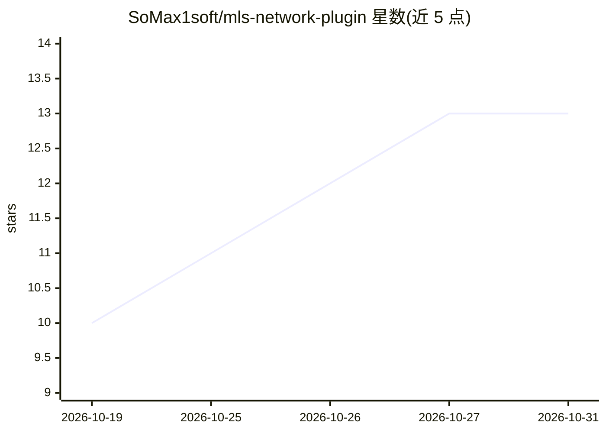

# SoMax1soft/mls-network-plugin

⭐ 13 · Java · NOASSERTION · 推送 2026-10-26 · [GitHub](https://github.com/SoMax1soft/mls-network-plugin) · [官网](https://mlsac.net) · 个人维护 · 中文 README

**基于云端神经网络的 Minecraft 服务器 AI 反作弊插件**

面向 Paper/Spigot/Folia 服务器的 Java 反作弊插件：采集玩家战斗行为（瞄准、点击、绕目标移动）的特征窗口，发送至 MLSAC 云端，由神经网络对 KillAura、TriggerBot、AimAssist、Reach 四类作弊进行评分；处置方式（警报、降伤、踢出、封禁）在 mlsac.net 的预设中配置。使用需许可证密钥（有免费档）。源码可读可构建，但不含 Ultra 模型的受保护传输层，Ultra 需官方 jar。PacketEvents 已内置，WorldGuard 可选。

## 筛选速览

| 维度 | 判定 | 备注 |
|---|---|---|
| AI 角色 | `ai-native` | 本体是模型或模型工具 |
| 许可风险 | `none` | NOASSERTION |
| 部署形态 | `None` |  |
| 模型依赖 | — | README 未给出锁定关系 |
| 硬件要求 | — | 无带数字的原话,不猜 |
| 安装摩擦 | `medium` | 含编译或系统依赖之一 |
| 成熟度 | — | 结构信号不足 |

## 能力要点

- 神经网络检测 KillAura/TriggerBot/AimAssist/Reach 四类作弊
- 云端评分架构：本地采集特征窗口，云端模型判定
- 支持 Paper 及分支、Spigot、Folia，MC 1.16.5–26.x，按 Java 17/21 提供不同 jar
- 处置（警报/降伤/踢出/封禁）通过 mlsac.net 预设配置

## 适用场景

- 服务器管理员检测并处置战斗类作弊玩家
- 通过网页预设自定义作弊处置策略（含区域免检）
- 从源码构建并在自有服务器运行

## 场景标签

`网络安全` · 领域:学习与行业

## 证据(README 行号)

> L3: **MLSAC** is a machine-learning anticheat. The plugin watches how players fight — aim, clicks, movement
> L4: around the target — and sends compact feature windows to the MLSAC cloud, where neural networks score
> L5: them for KillAura, TriggerBot, AimAssist and Reach. What happens to a cheater (alerts, damage

## 星数曲线

2026-10-19 10 → 2026-10-31 13（+3）

---
*卡片 v1 · prompt 1.4 · 生成 2026-10-31 · 置信度 high · 依据 README sha `3a1a35e392ec` · [字段定义](../../DATASET.md)*
