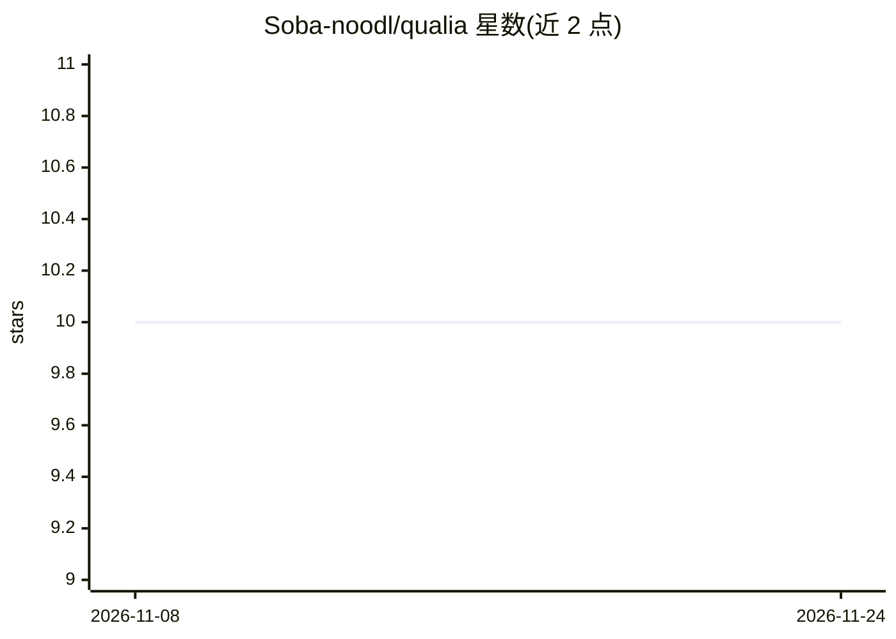

# Soba-noodl/qualia

⭐ 10 · TypeScript · MIT · 推送 2026-07-07 · [GitHub](https://github.com/Soba-noodl/qualia) · 组织维护

**面向设计团队的 AI UX 审计工具：截图生成评分与改进建议**

Vite/React 网页应用加 Figma 插件，后端为 Supabase。用户创建项目、上传单屏截图或 2–10 张流程图，Supabase Edge Functions 调用 Google Gemini 生成结构化 UX 审计（评分、问题清单、'one big thing' 摘要）。支持按问题逐条反馈并用于后续再审计、附加 Notion/Google Drive 文档作上下文、每日用量配额与分析面板。仓库为商业项目的 MIT 快照，2026 年 5 月归档，Issues/PR 不再维护。

## 筛选速览

| 维度 | 判定 | 备注 |
|---|---|---|
| AI 角色 | `ai-native` | 本体是模型或模型工具 |
| 许可风险 | `permissive` | MIT |
| 部署形态 | `library` | 以包/库形式分发 |
| 模型依赖 | — | README 未给出锁定关系 |
| 硬件要求 | — | 无带数字的原话,不猜 |
| 安装摩擦 | `low` | 无编译、无系统依赖或容器化 |
| 成熟度 | — | 结构信号不足 |

## 能力要点

- 上传截图或流程图生成结构化 UX 审计（评分、问题、建议）
- Figma 插件内直接运行审计并回绘问题高亮
- 用户反馈作为高优先级上下文参与再审计
- 可附加 Notion/Google Drive 文档作为审计上下文

## 适用场景

- 对设计稿截图批量做可用性与可访问性审查
- 在 Figma 内对选定画板运行 UX 审计
- 跟踪设计迭代中问题修复的再审计结果

## 场景标签

 · 领域:设计/开发工具

## 证据(README 行号)

> L6: Design teams create projects, upload screenshots or flows, and Qualia generates structured UX audits (scores, issues
> L12: - **AI-driven UX analysis**: Supabase Edge Functions call AI to generate scores, issue lists, and “one big thing” s

## 星数曲线

2026-11-08 10 → 2026-11-24 10（+0）

---
*卡片 v1 · prompt 1.4 · 生成 2026-11-20 · 置信度 high · 依据 README sha `7d93bacfc586` · [字段定义](../../DATASET.md)*
