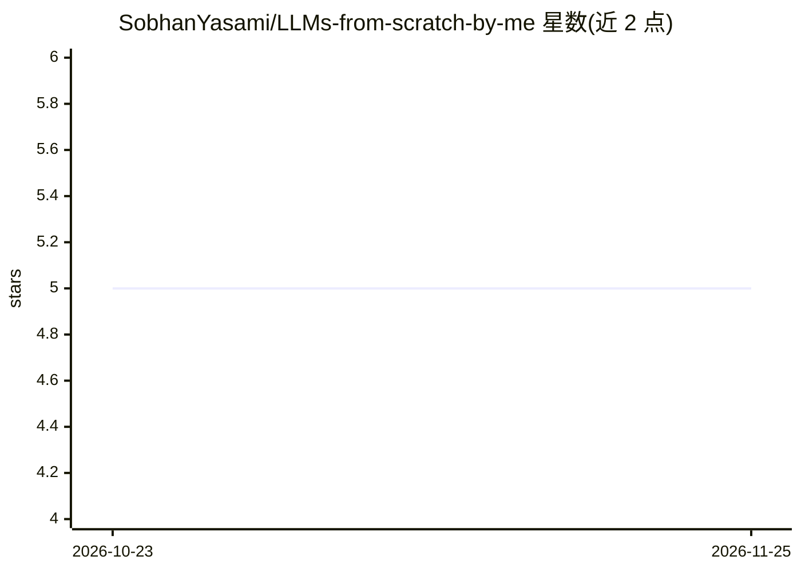

# SobhanYasami/LLMs-from-scratch-by-me

⭐ 5 · HTML · 推送 2026-10-19 · [GitHub](https://github.com/SobhanYasami/LLMs-from-scratch-by-me) · [官网](https://sobhanyasami.github.io/LLMs-from-scratch-by-me/) · 个人维护

**用五种语言逐章实现《从零构建 LLM》的学习仓库**

跟随 Sebastian Raschka 的《Build a Large Language Model (From Scratch)》一书的学习型仓库，将同一套教材内容用 Python、Go、Rust、C、Zig 五种语言以统一布局实现并排对照：覆盖分词、数据集、嵌入、注意力、GPT 模型与训练等章节模块，五个版本输出相同的 token ID 与模型结果。附带由 Hugo 构建、以英文与波斯语发布的教程文档站点，代码标签页在构建时直接读取真实源码。

## 筛选速览

| 维度 | 判定 | 备注 |
|---|---|---|
| AI 角色 | `ai-knowledge` | 知识聚合/清单类 |
| 许可风险 | `none` | — |
| 部署形态 | `None` |  |
| 模型依赖 | — | README 未给出锁定关系 |
| 硬件要求 | — | 无带数字的原话,不猜 |
| 安装摩擦 | `low` | 无编译、无系统依赖或容器化 |
| 成熟度 | — | 结构信号不足 |

## 能力要点

- 同一教材内容以 Python/Go/Rust/C/Zig 五语言实现，布局一致可并排对照
- 覆盖分词、嵌入、注意力、GPT 模型到训练（AdamW、checkpoint、OpenAI 权重加载）的章节模块
- ch04-124m 可运行真实 124M 参数 GPT-2（约 1 GB 内存，需 release 构建）
- Hugo 文档站点支持英/波斯双语，代码页构建时读取真实源文件

## 适用场景

- 对照多种系统语言理解 LLM 各组件的实现细节
- 跟随书的章节进度逐步动手构建 GPT 模型
- 查阅配套的双语教程文档站点学习全书内容

## 场景标签

`教程课程` `模型训练` · 领域:学习与行业

## 证据(README 行号)

> L3: Learning repo and future reference, following *Build a Large Language Model (From Scratch)* by Sebastian Raschka. Th
> L31: A living tutorial and reference for the whole book, built with Hugo from `site/` and published with GitHub Pages. I

## 星数曲线

2026-10-23 5 → 2026-11-25 5（+0）

---
*卡片 v1 · prompt 1.4 · 生成 2026-11-21 · 置信度 high · 依据 README sha `cf03c67b5d7d` · [字段定义](../../DATASET.md)*
