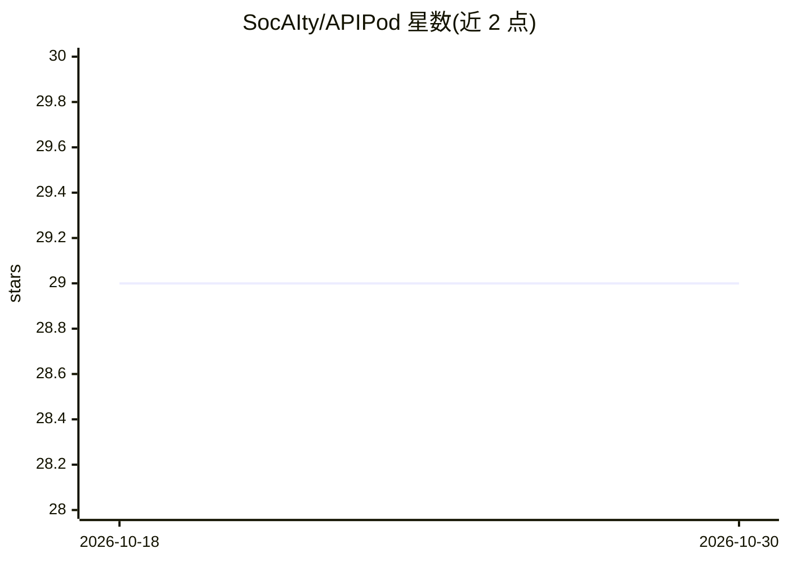

# SocAIty/APIPod

⭐ 29 · Python · GPL-3.0 · 推送 2026-10-29 · [GitHub](https://github.com/SocAIty/APIPod) · 组织维护

**面向 AI 服务的 FastAPI 风格框架：本地开发到 GPU 云部署**

基于 FastAPI 的 AI 服务构建框架：以 FastAPI 写法定义端点，内置异步作业队列与进度追踪、图像/音频/视频标准化 I/O（media-toolkit）、OpenAI 兼容的 chat/embeddings/TTS 等请求响应 schema。提供模型加载预设（transformers/vLLM 引擎）与 apipod.serve 一行注册 OpenAI 兼容端点。命令行覆盖开发、serverless 仿真、Docker 构建与经 Socaity 平台部署到 RunPod/Azure 等云端；analyze/deploy 命令需 Socaity 登录，其余功能可离线使用。

## 筛选速览

| 维度 | 判定 | 备注 |
|---|---|---|
| AI 角色 | `ai-ecosystem` | LLM/agent 周边工具 |
| 许可风险 | `viral` | GPL-3.0 |
| 部署形态 | `self-host` | docker 或自建部署 |
| 模型依赖 | local-ok | 支持本地模型 |
| 硬件要求 | — | 无带数字的原话,不猜 |
| 安装摩擦 | `low` | 无编译、无系统依赖或容器化 |
| 成熟度 | — | 结构信号不足 |

## 能力要点

- 同一代码在开发、serverless 仿真与 GPU 云环境间零改动运行
- 内置异步作业队列与 job_id 轮询，无需 Celery/Redis/Kubernetes
- OpenAI 兼容 schema，OpenAI 客户端开箱可用
- apipod build 生成含 CUDA/cuDNN/ffmpeg 的兼容 Dockerfile

## 适用场景

- 把长耗时推理任务封装为带作业队列的 web API
- 在本地仿真 serverless 行为后再部署到 RunPod 等 GPU 云
- 为 chat/embeddings/TTS 等模型快速暴露 OpenAI 兼容端点

## 场景标签

`推理引擎` · 领域:训练与推理

## 证据(README 行号)

> L8:  APIPod combines the developer experience of FastAPI with the power of Serverless GPU computing.
> L27: 2. **Drop-in FastAPI** — if you know FastAPI, you already know APIPod. Built on top of it, with batteries included 
> L29: 4. **OpenAI-compatible schemas** — built-in request/response schemas for chat, completions, embeddings, TTS, transc

## 星数曲线

2026-10-18 29 → 2026-10-30 29（+0）

---
*卡片 v1 · prompt 1.4 · 生成 2026-10-26 · 置信度 mid · 依据 README sha `6f35041f4233` · [字段定义](../../DATASET.md)*
