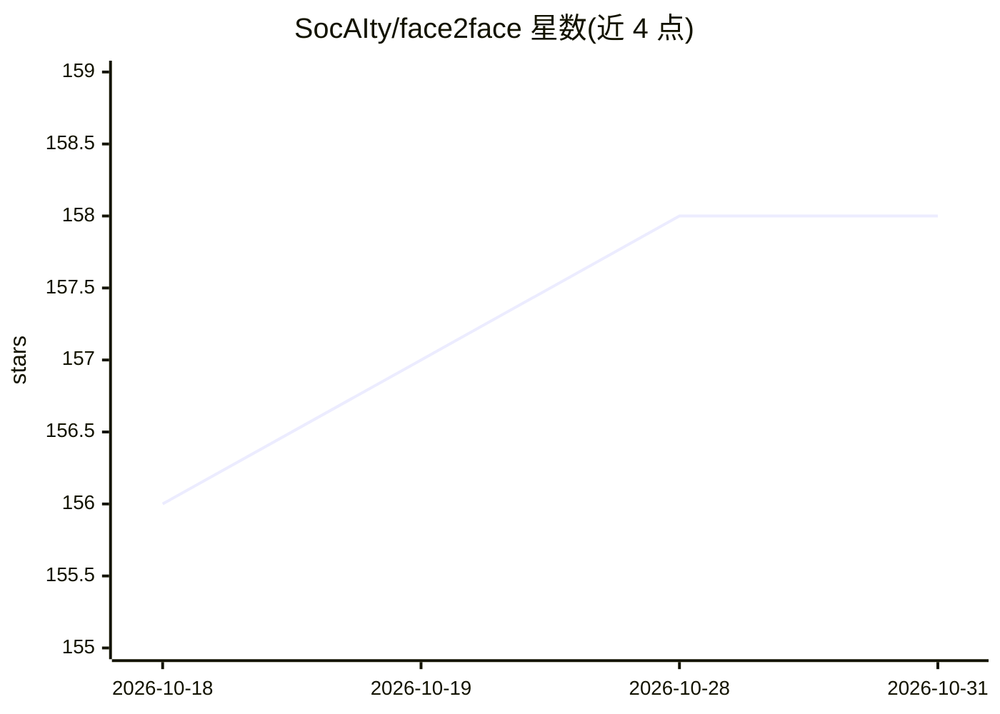

# SocAIty/face2face

⭐ 158 · Python · MIT · 推送 2026-06-22 · [GitHub](https://github.com/SocAIty/face2face) · 组织维护

**图像/视频换脸 SDK 与 API 服务：换脸、人脸嵌入与画质增强**

基于 Insightface（inswapper/roop 预训练模型）的单样本换脸工具，支持图像与视频换脸、创建可持久化的人脸嵌入（按名字复用换脸）、人脸识别配对换脸，以及用 GPEN/GFPGAN 模型做人脸画质增强（最高上采样 2048）。提供 Python SDK 与 OpenAPI Web 服务两种使用方式，也可经 socaity SDK 云端调用（无需 GPU）。本地推理要求 Python 3.7+、最少 5GB 内存，推荐 8GB VRAM GPU 但可跑 CPU；视频服务需额外安装 ffmpeg，模型自动下载。

## 筛选速览

| 维度 | 判定 | 备注 |
|---|---|---|
| AI 角色 | `ai-native` | 本体是模型或模型工具 |
| 许可风险 | `permissive` | MIT |
| 部署形态 | `library` | 以包/库形式分发 |
| 模型依赖 | — | README 未给出锁定关系 |
| 硬件要求 | — | 无带数字的原话,不猜 |
| 安装摩擦 | `medium` | 含编译或系统依赖之一 |
| 成熟度 | — | 结构信号不足 |

## 能力要点

- 单样本换脸，支持图像、视频及 anime 内容
- add_face 创建持久化人脸嵌入，按名字或识别配对换脸
- GPEN/GFPGAN 人脸增强模型，可独立于换脸使用
- 可部署为 OpenAPI Web 服务，支持多 GPU 多进程

## 适用场景

- 批量替换图像或视频中的人脸
- 为已识别人物建立人脸嵌入库以便复用换脸
- 提升换脸或普通人像的画质分辨率

## 场景标签

`图像视频处理` · 领域:感知与多模态

## 证据(README 行号)

> L5: Face2Face is a generative AI technology to swap faces (aka Deep Fake) in images from one to another.
> L21: We provide the face swapping functionality as SDK and as a convenient web (openAPI) API with APIPod.

## 星数曲线

2026-10-18 156 → 2026-10-31 158（+2）

---
*卡片 v1 · prompt 1.4 · 生成 2026-10-22 · 置信度 high · 依据 README sha `b08275fb3758` · [字段定义](../../DATASET.md)*
