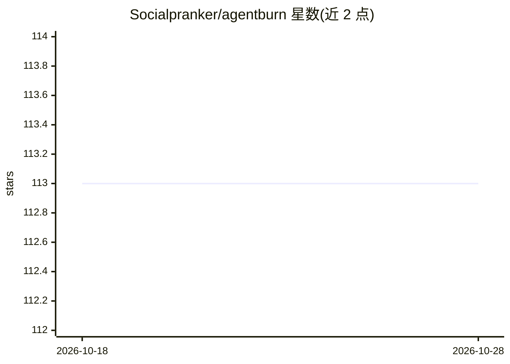

# Socialpranker/agentburn

⭐ 113 · Python · MIT · 推送 2026-10-28 · [GitHub](https://github.com/Socialpranker/agentburn) · [官网](https://socialpranker.github.io/agentburn/) · 个人维护

**本地 AI agent 用量剖析器：定位限额窗口与花费去向**

面向 Claude Code、Codex CLI、OpenClaw、Hermes Agent 等 CLI agent 的本地只读剖析工具：读取 agent 自身日志，输出滚动 5 小时用量窗口的峰值/典型值与构成、从记录的截断时刻推算用量天花板与到墙时间、长上下文成本与 /clear 节省估算、按 git 提交分摊成本、按来源（cron/subagent/网关）拆分花费与隔夜账单，并以 `fix` 生成可粘贴的配置补丁（默认 dry-run，无 --apply）。按 requestId 去重避免重复计数，解析结果按文件大小与 mtime 缓存。零依赖，无网络调用与遥测。

## 筛选速览

| 维度 | 判定 | 备注 |
|---|---|---|
| AI 角色 | `ai-ecosystem` | LLM/agent 周边工具 |
| 许可风险 | `permissive` | MIT |
| 部署形态 | `library` | 以包/库形式分发 |
| 模型依赖 | — | README 未给出锁定关系 |
| 硬件要求 | — | 无带数字的原话,不猜 |
| 安装摩擦 | `low` | 无编译、无系统依赖或容器化 |
| 成熟度 | — | 结构信号不足 |

## 能力要点

- 峰值/典型 5 小时窗口对比与天花板推算（取多次截断的中位数）
- 长上下文成本、/clear 节省与技能加载成本测量
- 按来源（cron/subagent/网关）与 git 提交拆分花费
- `fix` 生成经源码核验的可粘贴配置补丁，仅 dry-run

## 适用场景

- 订阅用户想知道哪个时间窗口把限额用光、还剩多久到墙
- API 付费用户追踪隔夜账单与重试风暴等异常花费
- 通过 statusline 在 Claude Code 内实时查看窗口余量

## 场景标签

`LLM 可观测性` · 领域:评测与运维

## 证据(README 行号)

> L11: **Claude Code · Codex CLI · Gemini CLI · opencode · OpenClaw · Hermes Agent** — one normalized core, local, read-on
> L186: ||**agentburn**|ccusage|codeburn|built-in `/usage`|

## 星数曲线

2026-10-18 113 → 2026-10-28 113（+0）

---
*卡片 v1 · prompt 1.4 · 生成 2026-10-23 · 置信度 high · 依据 README sha `2f1389488ff5` · [字段定义](../../DATASET.md)*
