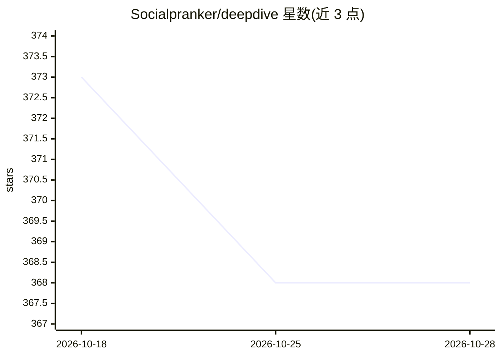

# Socialpranker/deepdive

⭐ 369 · Python · MIT · 推送 2026-10-25 · [GitHub](https://github.com/Socialpranker/deepdive) · [官网](https://socialpranker.github.io/deepdive/) · 个人维护

**给 Claude Code 用户的结构化深度研究技能：13 阶段调研流水线**

面向 Claude Code 的研究技能（skill），将“调研某主题”转为 13 阶段流水线：问题重构与计划评审门（3.7）、并行子代理搜索、claims-ledger 三角验证（要求≥2 独立根来源）、CRAG 式证据过滤、多角度红队与四层引用核验（faithfulness 判定 SUPPORTED/PARTIAL/UNSUPPORTED）。产出可复用的文件夹（plan.md、claims.csv、memo.md 决策备忘录）。内置 106 个报告块、29 个搜索通道、460+ 统计来源与 47+ 免认证 API 端点，GitHub Actions 每周校验端点有效性。方法论可移植到其他 LLM（Codex、Gemini、本地模型）。以 git clone 安装到 Claude Code skills 目录。

## 筛选速览

| 维度 | 判定 | 备注 |
|---|---|---|
| AI 角色 | `ai-ecosystem` | LLM/agent 周边工具 |
| 许可风险 | `permissive` | MIT |
| 部署形态 | `None` |  |
| 模型依赖 | locked-api |  |
| 硬件要求 | — | 无带数字的原话,不猜 |
| 安装摩擦 | `low` | 无编译、无系统依赖或容器化 |
| 成熟度 | — | 结构信号不足 |

## 能力要点

- 13 阶段流水线含计划评审门、并行子代理搜索与红队审查
- 引用核验：检查来源是否蕴含声明，输出 faithfulness 判定
- 106 报告块 + 29 搜索通道 + 460+ 统计来源 + 47+ 免认证 API 端点
- validate_phases.py 校验各阶段产物，红门时不得报告完成

## 适用场景

- 让 Claude Code 执行可溯源、可复查的深度调研并产出决策备忘录
- 对 AI 生成报告的引用做逐条核验
- 跨模型复用结构化研究方法论

## 场景标签

`科研工具` `RAG` · 领域:知识与检索

## 证据(README 行号)

> L3: ### A structured meta-research skill for Claude Code
> L25: A Claude Code skill that turns **"research this topic"** into a ** 13 -phase pipeline** with hypothesis testing, pa
> L81:  For other LLMs (Codex, Gemini, local)

## 星数曲线

2026-10-18 373 → 2026-10-28 368（-5）

---
*卡片 v1 · prompt 1.4 · 生成 2026-10-21 · 置信度 high · 依据 README sha `72e0572d78cd` · [字段定义](../../DATASET.md)*
