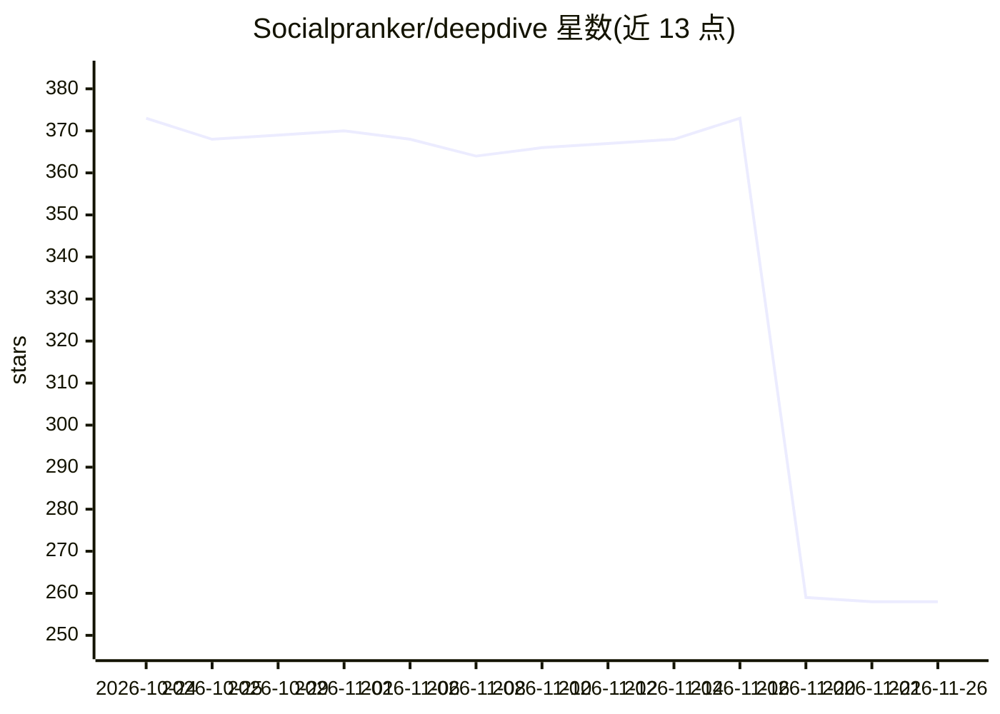

# Socialpranker/deepdive

⭐ 258 · Python · MIT · 推送 2026-11-22 · [GitHub](https://github.com/Socialpranker/deepdive) · [官网](https://socialpranker.github.io/deepdive/) · 个人维护

**Claude Code 深度研究技能：把提问变成多阶段文档化调查流水线**

一个安装到 Claude Code 的 skill（SKILL.md + references + 校验脚本），把“研究某主题”组织为 13 个阶段的流水线：问题重构与分类路由、计划评审门、并行子代理搜索、claims 账本与来源三角验证、CRAG 式证据过滤、多角度红队审查、引用忠实性核验与决策走查。每阶段标注所用 Claude 模型（Opus/Sonnet/Haiku）与成本预估，输出可复用的文件夹（plan.md、claims.csv、evidence/、验证 JSON、报告）。方法论可手动移植到其他 LLM；运行依赖 Claude Code 或启用 Skills 的 Claude Desktop。

## 筛选速览

| 维度 | 判定 | 备注 |
|---|---|---|
| AI 角色 | `ai-native` | 本体是模型或模型工具 |
| 许可风险 | `permissive` | MIT |
| 部署形态 | `None` |  |
| 模型依赖 | locked-api |  |
| 硬件要求 | — | 无带数字的原话,不猜 |
| 安装摩擦 | `low` | 无编译、无系统依赖或容器化 |
| 成熟度 | — | 结构信号不足 |

## 能力要点

- 13 阶段流水线，每阶段按任务路由 Opus/Sonnet/Haiku 并预告成本
- plan-review 门与红队审查：执行前确认计划，合成时多角度对抗验证
- 四层引用核验：链接存活 + claim⊨quote 忠实性判定（SUPPORTED/PARTIAL/UNSUPPORTED）
- 内置 29 个搜索频道、460+ 统计来源目录、47+ 免费无鉴权 API 与每周自动同步校验

## 适用场景

- 把一次提问变成可复用、可追溯来源的研究报告
- 技术选型调查时要求对比性假设与红队审查
- 需要核验 AI 生成报告引用是否真实支撑论点

## 场景标签

`科研工具` · 领域:学习与行业

## 证据(README 行号)

> L27: A Claude Code skill that turns **"research this topic"** into a ** 13 -phase pipeline** with hypothesis testing, pa
> L91: The skill runs ** 13 phases** in order:
> L110: Each phase runs on a model matched to its task — Opus where reasoning multiplies (1/3/6), Haiku for the parallel f

## 星数曲线

2026-10-24 373 → 2026-11-26 258（-115）

---
*卡片 v1 · prompt 1.4 · 生成 2026-11-25 · 置信度 high · 依据 README sha `83424365c819` · [字段定义](../../DATASET.md)*
