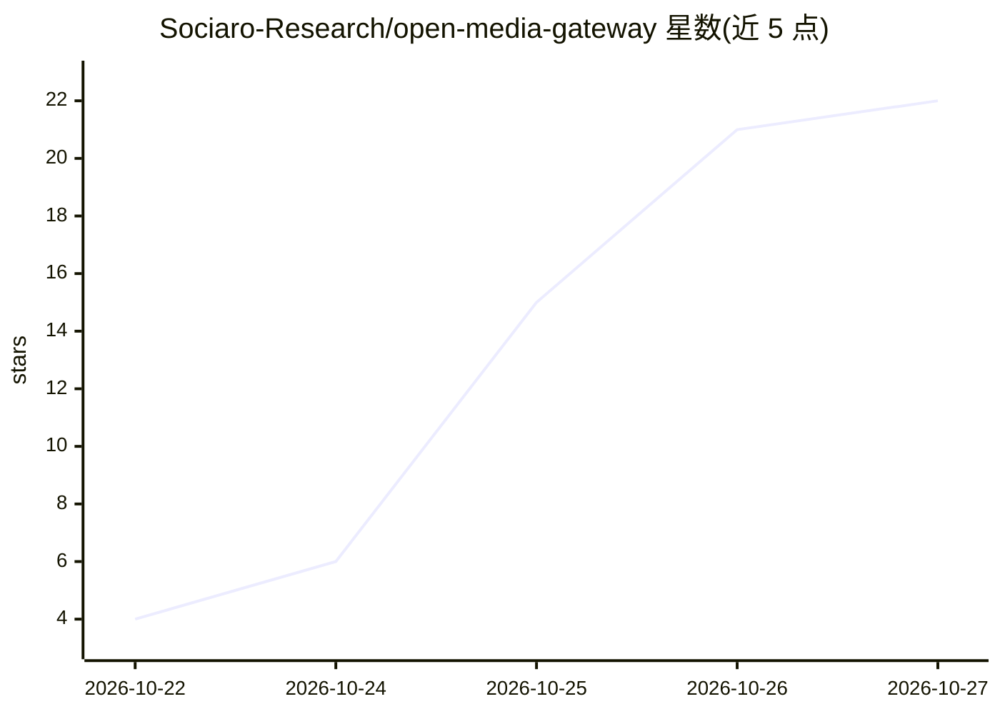

# Sociaro-Research/open-media-gateway

⭐ 22 · Go · Apache-2.0 · 推送 2026-10-23 · [GitHub](https://github.com/Sociaro-Research/open-media-gateway) · [官网](https://sociaro.com) · 组织维护

**自托管的 AI 媒体生成网关：统一 API 与控制台接入多家图像/视频/语音/音乐服务**

面向在应用中构建媒体生成功能的开发者与团队的 Open Media Gateway：把多个媒体生成服务商账号接入共享的浏览器控制台与异步 API，统一提交任务、轮询状态、接收 webhook 回调并下载结果。内置 OpenAI、BytePlus ModelArk、阿里云百炼、Agnes AI、Sonilo 及 mock 适配器；支持生成文件归档到本地或 S3 兼容存储、组织内共享生成历史、用量与成本估算。以 Docker Compose 发布 bundle 部署，无需付费账号即可用 mock 提供方试用；API 采用 OpenAI 风格端点与异步任务生命周期。

## 筛选速览

| 维度 | 判定 | 备注 |
|---|---|---|
| AI 角色 | `ai-ecosystem` | LLM/agent 周边工具 |
| 许可风险 | `permissive` | Apache-2.0 |
| 部署形态 | `self-host` | docker 或自建部署 |
| 模型依赖 | — | README 未给出锁定关系 |
| 硬件要求 | — | 无带数字的原话,不猜 |
| 安装摩擦 | `low` | 无编译、无系统依赖或容器化 |
| 成熟度 | — | 结构信号不足 |

## 能力要点

- 统一 API 接入多家媒体生成服务商，异步任务生命周期 + webhook
- 内置 OpenAI、BytePlus ModelArk、阿里云 Model Studio、Agnes AI、Sonilo 及 mock 适配器
- 生成文件归档至本地或 S3 兼容存储，含签名下载与预览 URL
- mock 提供方返回固定测试媒体，无需付费凭据即可试用

## 适用场景

- 在应用中通过一个 API 集成多家图像/视频/语音/音乐生成服务
- 团队在共享工作台试模型、复用参考文件并查看生成历史与成本
- 将生成结果统一归档到自有本地或 S3 兼容存储

## 场景标签

`模型网关` · 领域:Agent 开发

## 证据(README 行号)

> L5: Open Media Gateway connects your media provider accounts to a shared browser
> L12: - **Integrate once.** Submit jobs through a common API, check their status, and

## 星数曲线

2026-10-22 4 → 2026-10-27 22（+18）

---
*卡片 v1 · prompt 1.4 · 生成 2026-10-27 · 置信度 high · 依据 README sha `9b32b23950c5` · [字段定义](../../DATASET.md)*
