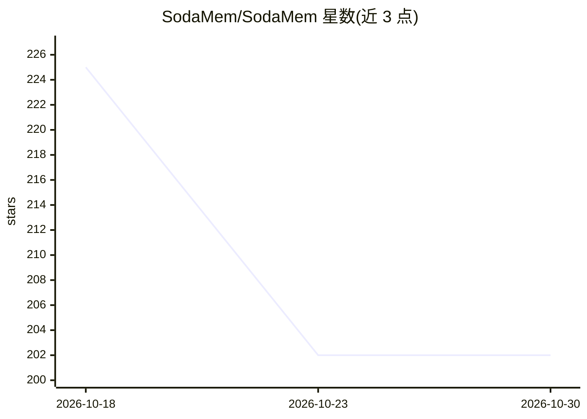

# SodaMem/SodaMem

⭐ 202 · Python · Apache-2.0 · 推送 2026-08-19 · [GitHub](https://github.com/SodaMem/SodaMem) · [官网](https://sodamem.com) · 组织维护 · 中文 README

**面向 AI agent 的自演化记忆层：可溯源、免 LLM 检索**

为 AI agent 提供长期记忆基础设施的 Python 库：以 FactEvent 数据模型存储事实，事实被取代时通过 SUPERSEDES 边关闭而非覆盖，每条记忆经外键链回溯到产生它的会话轮次；检索路径 build_context 不调用 LLM，输出确定性。提供 MCP 服务、HTTP API、TypeScript SDK，并适配 LangGraph、CrewAI、OpenAI Agents SDK、Vercel AI SDK 及 Claude Code、Cursor 等编码客户端（hooks 自动召回/留存）。基础安装仅四个依赖；默认配置无遥测，仅一次性下载 90MB 嵌入模型后可离线运行。

## 筛选速览

| 维度 | 判定 | 备注 |
|---|---|---|
| AI 角色 | `ai-ecosystem` | LLM/agent 周边工具 |
| 许可风险 | `permissive` | Apache-2.0 |
| 部署形态 | `self-host` | docker 或自建部署 |
| 模型依赖 | locked-api |  |
| 硬件要求 | — | 无带数字的原话,不猜 |
| 安装摩擦 | `low` | 无编译、无系统依赖或容器化 |
| 成熟度 | — | 结构信号不足 |

## 能力要点

- FactEvent→SourceSpan→RawTurn 外键链，每条记忆可溯源到具体轮次
- 检索零 LLM 调用，同库同查询结果确定
- ADD-only + SUPERSEDES 边与四条时间轴建模事实时效
- MCP 服务、HTTP API、TS SDK 与多种 agent 框架/编码客户端集成

## 适用场景

- 为 agent 框架接入长期记忆并保留来源可审计性
- 让 Claude Code、Cursor 等编码客户端自动召回和留存记忆
- 以共享服务形式多客户端共用一套记忆库

## 场景标签

`Agent 记忆` · 领域:Agent 开发

## 证据(README 行号)

> L3: **A self-evolving, agentic memory layer for AI agents.**
> L25: |**Hermes Agent**|MCP|`integrations/hermes/README.md`|
> L215: **MCP** — 8 tools, including `entity_timeline` (one entity's history in order,

## 星数曲线

2026-10-18 225 → 2026-10-30 202（-23）

---
*卡片 v1 · prompt 1.4 · 生成 2026-10-22 · 置信度 high · 依据 README sha `75a38f0d1e6f` · [字段定义](../../DATASET.md)*
