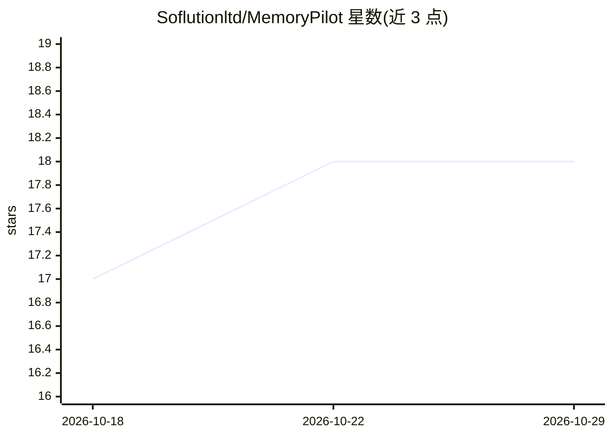

# Soflutionltd/MemoryPilot

⭐ 18 · Rust · NOASSERTION · 推送 2026-10-28 · [GitHub](https://github.com/Soflutionltd/MemoryPilot) · [官网](https://soflution.com) · 组织维护

**给 AI 助手/Coding Agent 的本地 MCP 记忆服务器**

用 Rust 实现的单二进制 MCP memory server，为 Cursor、Claude Desktop/Code、VS Code、Windsurf、Codex、ChatGPT 等客户端提供跨会话持久记忆。机制包括 BM25+向量 RRF 混合检索与交叉编码器重排（jina-embeddings-v5-text-nano、jina-v2-multilingual）、时序知识图谱、GraphRAG、AAAK 上下文压缩、自动分类与自动压实、记忆胶囊。零运行时依赖、本地运行、无 API 调用；README 披露 LongMemEval-S 与自建法语基准的检索指标，端到端 QA 准确率尚未测量。许可为 Source Available。

## 筛选速览

| 维度 | 判定 | 备注 |
|---|---|---|
| AI 角色 | `ai-ecosystem` | LLM/agent 周边工具 |
| 许可风险 | `none` | NOASSERTION |
| 部署形态 | `desktop` | 安装包/桌面程序 |
| 模型依赖 | — | README 未给出锁定关系 |
| 硬件要求 | — | 无带数字的原话,不猜 |
| 安装摩擦 | `low` | 无编译、无系统依赖或容器化 |
| 成熟度 | — | 结构信号不足 |

## 能力要点

- BM25+嵌入 RRF 混合检索，可开关的交叉编码器重排（关闭时约 28ms/查询）
- 时序知识图谱、GraphRAG、AAAK 压缩（宣称 5-10x token 节省）
- 插入时自动分类（重要性/类型/TTL）与自动压实，宣称零维护
- 单个 Rust 二进制、零运行时依赖、本地运行（约 35MB 二进制 + 首次运行下载约 530MB 模型）

## 适用场景

- 让 AI 编程助手跨会话记住项目上下文与偏好
- 为多客户端（Cursor/Claude/VS Code 等）提供统一本地记忆层
- 多语言（100+ 语言）记忆的语义检索与时序推理查询

## 场景标签

`Agent 记忆` `知识图谱` `语义搜索` · 领域:Agent 开发

## 证据(README 行号)

> L5:  The most advanced MCP memory server. Period.
> L20: AI coding assistants forget everything between sessions. MemoryPilot gives them persistent, searchable memory with 
> L24:  One-liner install for Cursor, Claude Desktop, VS Code, Windsurf, Claude Code, Codex and ChatGPT. Single Rust binar

## 星数曲线

2026-10-18 17 → 2026-10-29 18（+1）

---
*卡片 v1 · prompt 1.4 · 生成 2026-10-29 · 置信度 mid · 依据 README sha `56491af4e1b5` · [字段定义](../../DATASET.md)*
