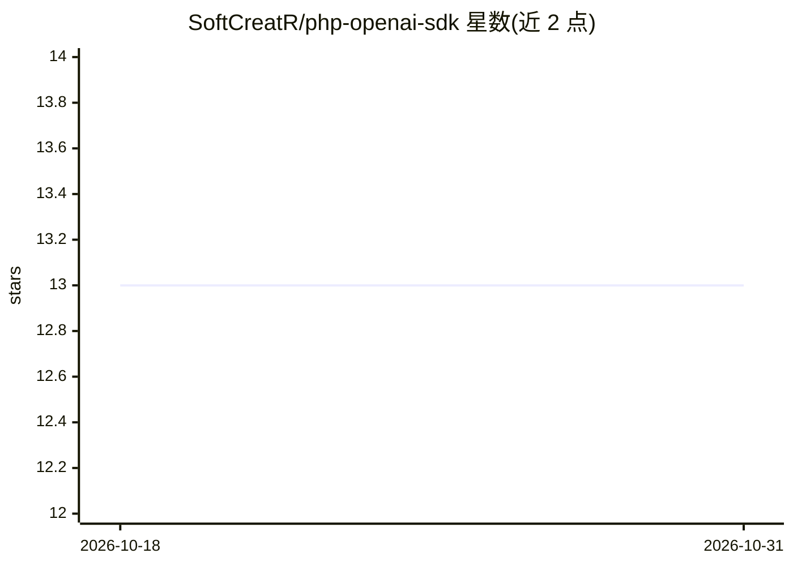

# SoftCreatR/php-openai-sdk

⭐ 13 · PHP · ISC · 推送 2026-10-12 · [GitHub](https://github.com/SoftCreatR/php-openai-sdk) · [官网](https://packagist.org/packages/softcreatr/php-openai-sdk) · 个人维护

**PHP 开发者的 OpenAI API 客户端 SDK**

基于 PSR-17/PSR-18 接口的 OpenAI API PHP 客户端，仅依赖 PSR 接口，可搭配 Guzzle 等任何合规实现。覆盖 Responses API、beta Agents API、SSE 流式（支持分块/CRLF/注释/[DONE]）、流式 multipart 上传、结构化异常（保留原始响应、状态码与 x-request-id）、webhook 签名验证（支持密钥轮换期间多签名）。提供每个 SDK 方法的 PHP 示例与庞大的方法目录（含组织/项目管理端点），需 PHP 8.1+ 与 JSON 扩展，通过 composer 安装。

## 筛选速览

| 维度 | 判定 | 备注 |
|---|---|---|
| AI 角色 | `ai-ecosystem` | LLM/agent 周边工具 |
| 许可风险 | `permissive` | ISC |
| 部署形态 | `None` |  |
| 模型依赖 | — | README 未给出锁定关系 |
| 硬件要求 | — | 无带数字的原话,不猜 |
| 安装摩擦 | `low` | 无编译、无系统依赖或容器化 |
| 成熟度 | — | 结构信号不足 |

## 能力要点

- 仅依赖 PSR-17/PSR-18 接口，HTTP 实现可替换
- SSE 流式解码支持任意分块、CRLF/LF、注释与 [DONE]
- webhook 签名验证支持密钥轮换的多 v1 签名
- 每个暴露的 SDK 方法均附带可运行示例

## 适用场景

- 在 PHP 项目中接入 OpenAI Responses/Agents API
- 处理 SSE 流式输出与 multipart 文件上传
- 验证 OpenAI webhook 请求签名

## 场景标签

 · 领域:LLM 基础设施/API 客户端

## 证据(README 行号)

> L8: A lightweight, underrated PSR-17/PSR-18 client for the current OpenAI API, with
> L42: The Responses API is the default interface for direct model requests, built-in tools, and stateful workflows.

## 星数曲线

2026-10-18 13 → 2026-10-31 13（+0）

---
*卡片 v1 · prompt 1.4 · 生成 2026-10-31 · 置信度 high · 依据 README sha `4b9442d3051c` · [字段定义](../../DATASET.md)*
