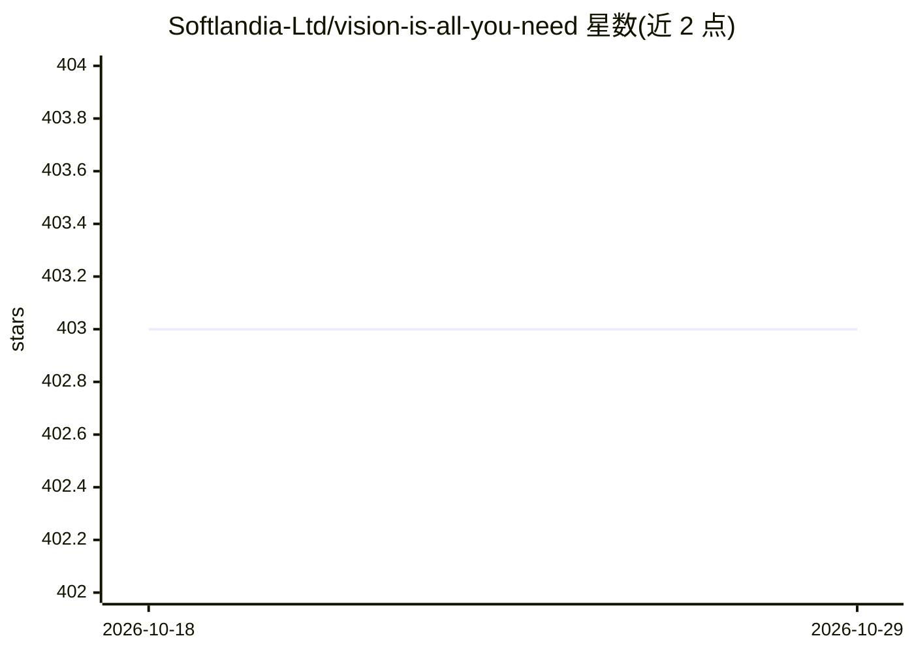

# Softlandia-Ltd/vision-is-all-you-need

⭐ 403 · TypeScript · MIT · 推送 2026-09-10 · [GitHub](https://github.com/Softlandia-Ltd/vision-is-all-you-need) · [官网](https://softlandia-ltd-prod--vision-is-all-you-need-web.modal.run/) · 组织维护

**演示项目：用视觉模型直接嵌入 PDF 页面的 V-RAG 问答 Demo**

Softlandia 团队发布的 Vision RAG 架构演示：将 PDF 页面转为图像，用 ColPali 视觉语言模型直接生成嵌入（省去文本切块），存入 Qdrant 向量数据库，检索时把查询与匹配页面图像交给 GPT4o/GPT4o-mini 生成回答。后端通过 Modal serverless 运行（A10G GPU），配 FastAPI API 与 React 前端。运行需要 Hugging Face 登录与 OpenAI API key。

## 筛选速览

| 维度 | 判定 | 备注 |
|---|---|---|
| AI 角色 | `ai-native` | 本体是模型或模型工具 |
| 许可风险 | `permissive` | MIT |
| 部署形态 | `library` | 以包/库形式分发 |
| 模型依赖 | — | README 未给出锁定关系 |
| 硬件要求 | — | 无带数字的原话,不猜 |
| 安装摩擦 | `low` | 无编译、无系统依赖或容器化 |
| 成熟度 | — | 结构信号不足 |

## 能力要点

- PDF 页面直接经 ColPali 视觉模型嵌入，不做文本切块
- Qdrant 向量库检索 + GPT4o/GPT4o-mini 图像理解生成回答
- Modal serverless 部署，提供 FastAPI API 与 React 前端

## 适用场景

- 体验视觉 RAG 架构处理 PDF 文档问答
- 参考无切块的文档检索实现方式
- 在 Modal 上部署文档图像检索演示

## 场景标签

`文档问答` `RAG` · 领域:知识与检索

## 证据(README 行号)

> L5: The V-RAG architecture utilizes a vision language model (VLM) to embed pages of PDF files (or any other document) as
> L26:  - we use GPT4o or GPT4o-mini in this demo
> L57: This will index the PDF file in to in-memory vector database. This will take some time depending on the size of the

## 星数曲线

2026-10-18 403 → 2026-10-29 403（+0）

---
*卡片 v1 · prompt 1.4 · 生成 2026-10-21 · 置信度 mid · 依据 README sha `b193010f5084` · [字段定义](../../DATASET.md)*
