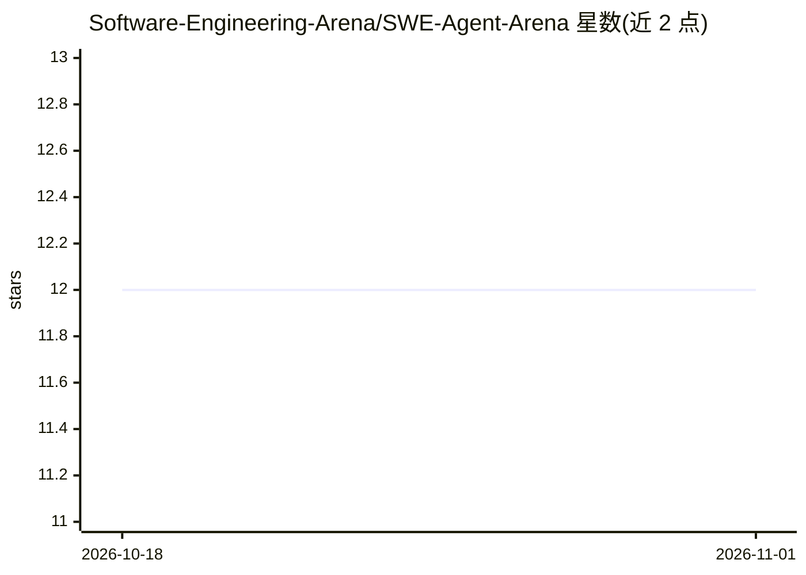

# Software-Engineering-Arena/SWE-Agent-Arena

⭐ 12 · JavaScript · 推送 2026-07-07 · [GitHub](https://github.com/Software-Engineering-Arena/SWE-Agent-Arena) · [官网](https://huggingface.co/spaces/SWE-Arena/SWE-Agent-Arena) · 组织维护

**评测 CLI 编码 agent 的开源平台：双匿名 agent 对战与投票**

面向软件工程任务的开源评测平台：同一任务由两个匿名 CLI 编码 agent 在隔离环境中并行执行，用户观看实时输出、对比 git diff 并投票，结果用于排行榜（Elo、Bradley-Terry MLE、PageRank、CEI、MCS 等指标）。支持多轮对话追问、通过 GitHub/GitLab/HuggingFace URL 自动注入仓库上下文（RepoChat）。以 Docker SDK 的 HF Space 形式提供，登录需 HF OAuth；自称 research preview，收集的对话数据可能以 CC-BY 类许可分发。

## 筛选速览

| 维度 | 判定 | 备注 |
|---|---|---|
| AI 角色 | `ai-ecosystem` | LLM/agent 周边工具 |
| 许可风险 | `none` | — |
| 部署形态 | `None` |  |
| 模型依赖 | — | README 未给出锁定关系 |
| 硬件要求 | — | 无带数字的原话,不猜 |
| 安装摩擦 | `low` | 无编译、无系统依赖或容器化 |
| 成熟度 | `idea` | |

## 能力要点

- 双匿名 agent 盲评对比，含实时输出流与并排 git diff
- 多轮对话：可对各 agent 独立发送后续指令
- RepoChat：从 GitHub/GitLab/HuggingFace URL 自动注入 issue、PR、文件上下文
- 排行榜支持 Elo、Bradley-Terry MLE、PageRank、CEI、MCS、Newman 模块度

## 适用场景

- 对比两个编码 agent 在真实 SE 任务上的表现并投票
- 查看编码 agent 的聚合排行榜排名
- 结合仓库上下文对 agent 做迭代式多轮评测

## 场景标签

`模型评测` · 领域:评测与运维

## 证据(README 行号)

> L12: An open-source platform for evaluating CLI coding agents on real software engineering tasks. Two anonymous agents t
> L18: - **Blind pairwise comparison** with live-streaming output and side-by-side git diffs

## 星数曲线

2026-10-18 12 → 2026-11-01 12（+0）

---
*卡片 v1 · prompt 1.4 · 生成 2026-11-01 · 置信度 high · 依据 README sha `0423ddc6538e` · [字段定义](../../DATASET.md)*
