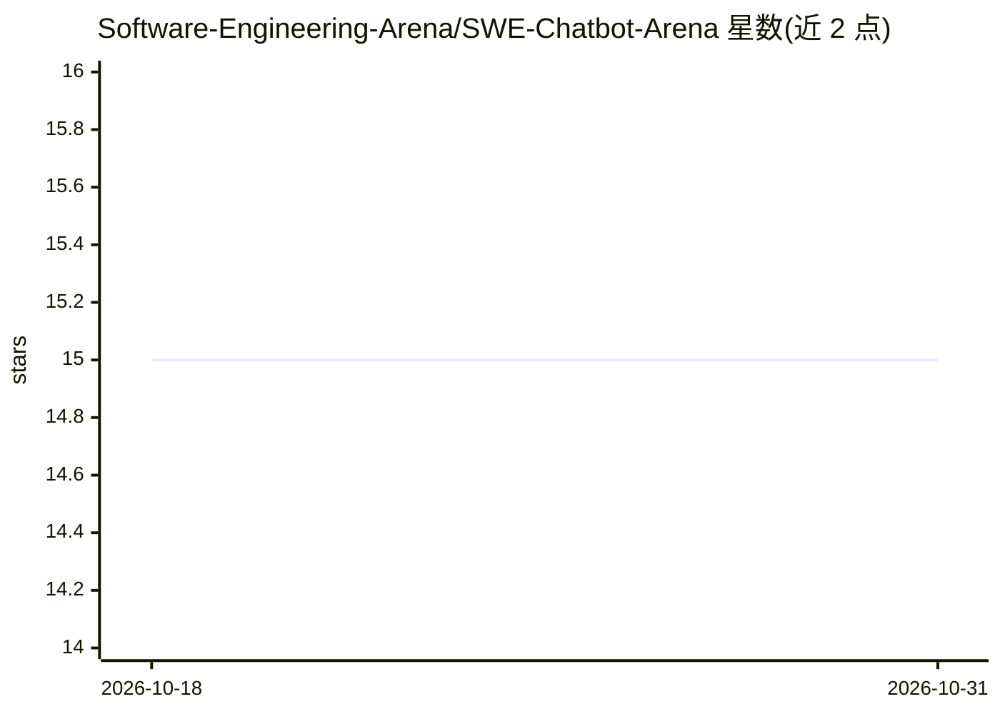

# Software-Engineering-Arena/SWE-Chatbot-Arena

⭐ 15 · Python · 推送 2026-04-04 · [GitHub](https://github.com/Software-Engineering-Arena/SWE-Chatbot-Arena) · [官网](https://huggingface.co/spaces/SWE-Arena/SWE-Chatbot-Arena) · 组织维护

**面向软件工程任务的 LLM 成对评测竞技场**

开源的软件工程任务 LLM 评测竞技场，以 Hugging Face 账号登录使用。用户输入调试、代码评审或重构等任务，可附仓库链接由 RepoChat 注入 issue、commit、PR 上下文；两个匿名模型多轮作答后投票，平台计算 Elo、PageRank 等指标，并用 gpt-oss-safeguard-20b 过滤非软件工程请求。面向需要对比模型在真实工程场景表现的研究者与开发者。

## 筛选速览

| 维度 | 判定 | 备注 |
|---|---|---|
| AI 角色 | `ai-ecosystem` | LLM/agent 周边工具 |
| 许可风险 | `none` | — |
| 部署形态 | `None` |  |
| 模型依赖 | — | README 未给出锁定关系 |
| 硬件要求 | — | 无带数字的原话,不猜 |
| 安装摩擦 | `low` | 无编译、无系统依赖或容器化 |
| 成熟度 | — | 结构信号不足 |

## 能力要点

- 两个匿名模型多轮作答后由用户投票比较
- RepoChat 注入 issue、commit、PR 等仓库上下文
- 提供 Elo、PageRank、特征向量中心性等指标
- 使用 gpt-oss-safeguard-20b 过滤非软件工程请求

## 适用场景

- 对模型在调试、代码评审、重构等软件工程工作流中做多轮对比评测
- 提交带仓库链接的任务并自动注入上下文
- 通过投票数据生成模型排名与多项指标

## 场景标签

`模型评测` · 领域:评测与运维

## 证据(README 行号)

> L14: An open-source arena for evaluating LLMs on **real software engineering tasks** — multi-turn, context-rich, and rep
> L30: - **Multi-round evaluation** — tests contextual understanding across turns
> L31: - **Rich metrics** — Elo, PageRank, eigenvector centrality, modularity clustering, self-play consistency, efficienc

## 星数曲线

2026-10-18 15 → 2026-10-31 15（+0）

---
*卡片 v1 · prompt 1.4 · 生成 2026-10-30 · 置信度 high · 依据 README sha `e1adf9deb5ef` · [字段定义](../../DATASET.md)*
