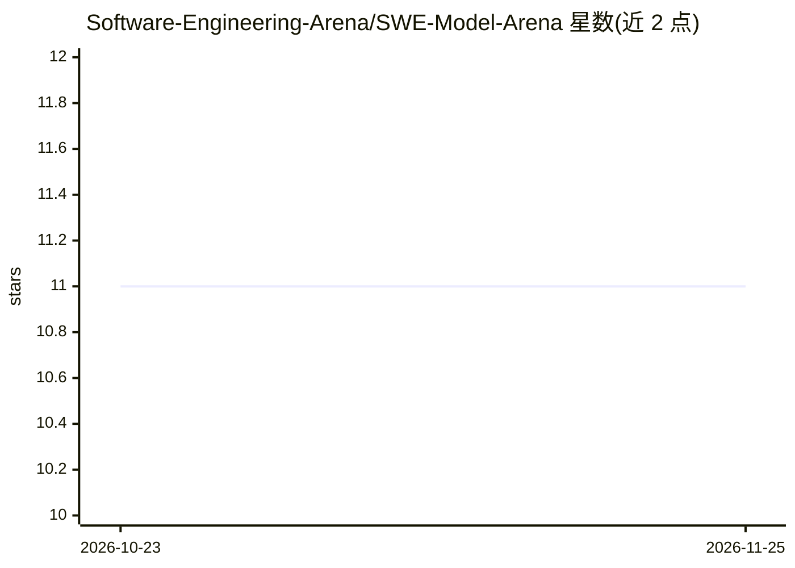

# Software-Engineering-Arena/SWE-Model-Arena

⭐ 11 · Python · 推送 2026-04-04 · [GitHub](https://github.com/Software-Engineering-Arena/SWE-Model-Arena) · [官网](https://huggingface.co/spaces/SWE-Arena/SWE-Model-Arena) · 组织维护

**SE 任务下工具调用模型两两对比评测平台**

开源的软件工程任务模型评测平台：两侧模型共享同一 scaffolding（opencode）、相同的工具、提示与沙箱环境，仅底层工具调用模型不同。模型通过 OpenRouter 在真实 git 仓库中读文件、写代码、执行命令；支持多轮追问与 git diff 并排对比，由用户投票判优；排行榜提供 Elo、PageRank、modularity 聚类、self-play 一致性与效率指标。部署为 Gradio 应用，提供 Hugging Face Spaces 在线入口。

## 筛选速览

| 维度 | 判定 | 备注 |
|---|---|---|
| AI 角色 | `ai-ecosystem` | LLM/agent 周边工具 |
| 许可风险 | `none` | — |
| 部署形态 | `None` |  |
| 模型依赖 | locked-api |  |
| 硬件要求 | — | 无带数字的原话,不猜 |
| 安装摩擦 | `low` | 无编译、无系统依赖或容器化 |
| 成熟度 | — | 结构信号不足 |

## 能力要点

- 同 scaffolding 控制变量式的两两模型对比评测
- 模型在沙箱化真实 git 仓库中读写代码、执行命令
- RepoChat 自动注入 GitHub/GitLab/Hugging Face 的仓库上下文
- 排行榜含 Elo、PageRank、聚类与效率指标

## 适用场景

- 对比两个工具调用模型在同一编程任务上的实际表现
- 提交带仓库上下文的任务做多轮迭代并投票判优
- 查看工具调用模型的排行榜与一致性指标

## 场景标签

`模型评测` · 领域:评测与运维

## 证据(README 行号)

> L14: An open-source platform for evaluating tool-calling models head-to-head. Both sides share the **same scaffolding** 
> L28: 2. **Models execute** — two randomly selected tool-calling models work independently via OpenRouter

## 星数曲线

2026-10-23 11 → 2026-11-25 11（+0）

---
*卡片 v1 · prompt 1.4 · 生成 2026-11-18 · 置信度 high · 依据 README sha `b32c704a3226` · [字段定义](../../DATASET.md)*
