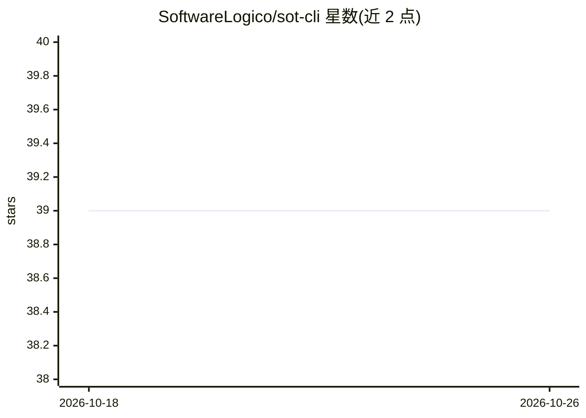

# SoftwareLogico/sot-cli

⭐ 39 · Python · MIT · 推送 2026-10-18 · [GitHub](https://github.com/SoftwareLogico/sot-cli) · [官网](https://www.linkedin.com/in/ramsesisaid) · 组织维护

**面向开发者的无护栏多供给商终端 AI Agent CLI**

Python 终端 AI Agent 工具：围绕自述的 Source of Truth (SoT) 方法将永久对话历史与临时文件状态分离，每轮从磁盘读取最新文件以控制 token 增长，并配合前缀匹配的提示缓存降低 API 成本。内置 31 个工具（含 shell、正则代码搜索、15 个浏览器自动化工具）与 MCP 扩展，支持 Boss-Worker 异步子代理委派与多工具批量编排。兼容任意 OpenAI 兼容 API，已测试 OpenRouter/LM Studio/OpenAI/Ollama/NVIDIA/Bedrock，可运行时切换。从源码以 pip 可编辑方式安装，需 Python 3.11+ 虚拟环境。

## 筛选速览

| 维度 | 判定 | 备注 |
|---|---|---|
| AI 角色 | `ai-native` | 本体是模型或模型工具 |
| 许可风险 | `permissive` | MIT |
| 部署形态 | `library` | 以包/库形式分发 |
| 模型依赖 | local-ok | 支持本地模型 |
| 硬件要求 | — | 无带数字的原话,不猜 |
| 安装摩擦 | `low` | 无编译、无系统依赖或容器化 |
| 成熟度 | — | 结构信号不足 |

## 能力要点

- SoT 方法：每轮从磁盘读取最新文件，分离永久历史与临时状态
- 31 个内置工具 + MCP 扩展，含 15 个浏览器自动化工具（基于 browser-use）
- Boss-Worker JIT 子代理委派与多工具单轮批量编排
- 多供给商运行时切换，兼容任意 OpenAI 兼容 API

## 适用场景

- 在终端用自然语言驱动 AI 读写代码、执行 shell 与浏览网页
- 通过廉价子代理委派试错任务以节省上下文与 API 成本
- 在本地 Ollama/LM Studio 或云端多供给商间切换运行同一 Agent

## 场景标签

`编码 Agent` `多智能体` `浏览器自动化` · 领域:Agent 开发

## 证据(README 行号)

> L15: **A pragmatic, limitless, multi-provider terminal assistant built for developers who hate bloated frameworks.**
> L17: `sot-cli` is a limitlessly local Python CLI designed to unleash the true reasoning power of modern LLMs on your pro
> L27: - **🌐 Multi-Provider**: Switch OpenRouter/LMStudio/OpenAI/Ollama/NVIDIA/Bedrock live.

## 星数曲线

2026-10-18 39 → 2026-10-26 39（+0）

---
*卡片 v1 · prompt 1.4 · 生成 2026-10-25 · 置信度 high · 依据 README sha `de91317847aa` · [字段定义](../../DATASET.md)*
