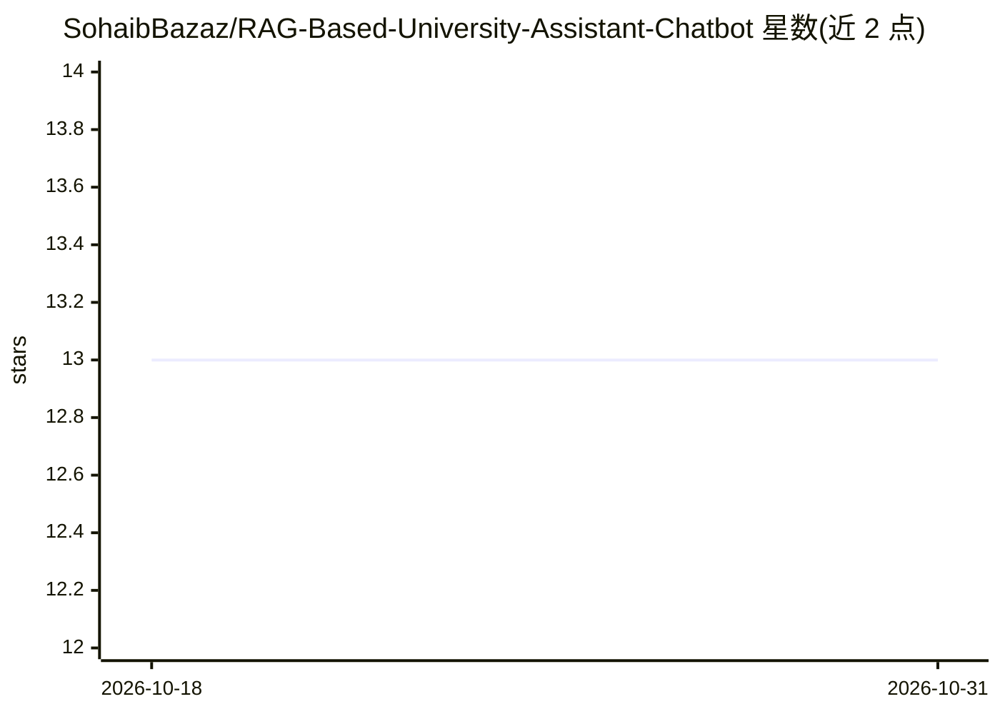

# SohaibBazaz/RAG-Based-University-Assistant-Chatbot

⭐ 13 · Python · 推送 2025-12-22 · [GitHub](https://github.com/SohaibBazaz/RAG-Based-University-Assistant-Chatbot) · 个人维护

**面向大学生的 PDF 问答聊天机器人（RAG + Gemini）**

学期项目：基于 Streamlit 的 Web 聊天机器人，读取上传的大学 PDF（如招生指南、FAQ），用 PDFPlumber 抽取并切分文本，通过检索找到与问题相关的片段，再调用 Google Gemini API 生成简短回答。技术栈为 Python、LangChain、Streamlit、PDFPlumber、NumPy、scikit-learn。知识库来自巴基斯坦 20 所大学网站的 FAQ 与学生表单问题汇总成的 PDF。运行需克隆仓库、pip 安装依赖并提供 Gemini API key。

## 筛选速览

| 维度 | 判定 | 备注 |
|---|---|---|
| AI 角色 | `ai-native` | 本体是模型或模型工具 |
| 许可风险 | `none` | — |
| 部署形态 | `library` | 以包/库形式分发 |
| 模型依赖 | — | README 未给出锁定关系 |
| 硬件要求 | — | 无带数字的原话,不猜 |
| 安装摩擦 | `low` | 无编译、无系统依赖或容器化 |
| 成熟度 | — | 结构信号不足 |

## 能力要点

- 读取大学 PDF 并切分为可检索片段
- 检索相关片段后调用 Google Gemini API 生成回答
- 基于 Streamlit 的 Web 界面
- FAQ 数据来自 20 所巴基斯坦大学网站与学生提问表单

## 适用场景

- 我上传大学 FAQ PDF，向聊天机器人提问常见问题
- 替客服/社群自动回答学生重复性咨询

## 场景标签

`聊天机器人` `RAG` `文档问答` · 领域:对话与助手

## 证据(README 行号)

> L3: This is an AI chatbot that helps university students by answering their questions using uploaded PDF files. It uses 
> L32: - Gives a short and helpful answer using Google's Gemini AI.

## 星数曲线

2026-10-18 13 → 2026-10-31 13（+0）

---
*卡片 v1 · prompt 1.4 · 生成 2026-10-31 · 置信度 high · 依据 README sha `7b841fc5d72f` · [字段定义](../../DATASET.md)*
