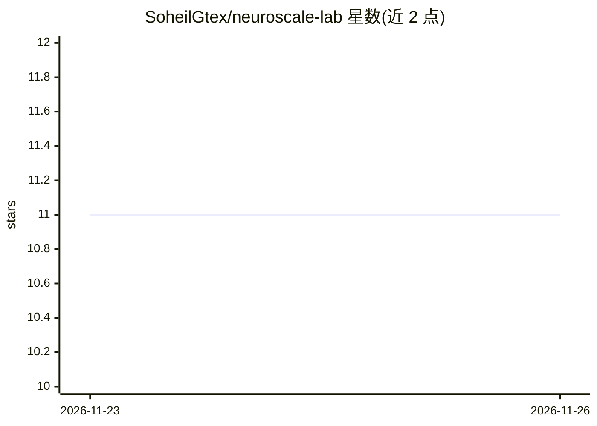

# SoheilGtex/neuroscale-lab

⭐ 11 · Python · MIT · 推送 2026-10-15 · [GitHub](https://github.com/SoheilGtex/neuroscale-lab) · 个人维护

**面向科研的可复现 EEG 复杂度与认知负荷建模平台**

可复现研究软件平台，检验 EEG 置换熵特征是否在常规频谱特征之上为认知负荷分类提供增量预测价值。基于 OpenNeuro/NEMAR 公开的 18 人 n-back 数据集，完成特征提取（置换熵、多尺度粗粒化、频谱特征）、SQLite 数据集成与参与者分组五折交叉验证，并发布校正后的全队列结果与研究报告。探索性发现为熵特征未表现出相对频谱基线的增量收益；项目明确标注结果非临床、非因果结论。源码 MIT 许可，数据集 CC0。

## 筛选速览

| 维度 | 判定 | 备注 |
|---|---|---|
| AI 角色 | `ai-native` | 本体是模型或模型工具 |
| 许可风险 | `permissive` | MIT |
| 部署形态 | `library` | 以包/库形式分发 |
| 模型依赖 | — | README 未给出锁定关系 |
| 硬件要求 | — | 无带数字的原话,不猜 |
| 安装摩擦 | `low` | 无编译、无系统依赖或容器化 |
| 成熟度 | — | 结构信号不足 |

## 能力要点

- 18 名参与者、1,012,776 条特征记录的校正全队列分析
- 参与者分组五折交叉验证，支持负结果报告
- 版本锁定数据集（NEMAR on007169 / OpenNeuro ds007169）与验证清单
- 合成数据 demo 在 seed 20261014 下确定性可复现

## 适用场景

- 复现或扩展 EEG 熵特征 vs 频谱特征的认知负荷分类实验
- 学习可复现科研数据工程流程（QC、版本锁定、验证清单）
- 查看已发布的全队列特征表与研究报告

## 场景标签

`科研工具` · 领域:学习与行业

## 证据(README 行号)

> L10: **NeuroScale Lab** is a reproducible research software platform testing whether
> L61: The current verified empirical run covers all 18 released participants. It retained 4,442 of 8,665 labeled task eve

## 星数曲线

2026-11-23 11 → 2026-11-26 11（+0）

---
*卡片 v1 · prompt 1.4 · 生成 2026-11-23 · 置信度 high · 依据 README sha `8492457ca779` · [字段定义](../../DATASET.md)*
