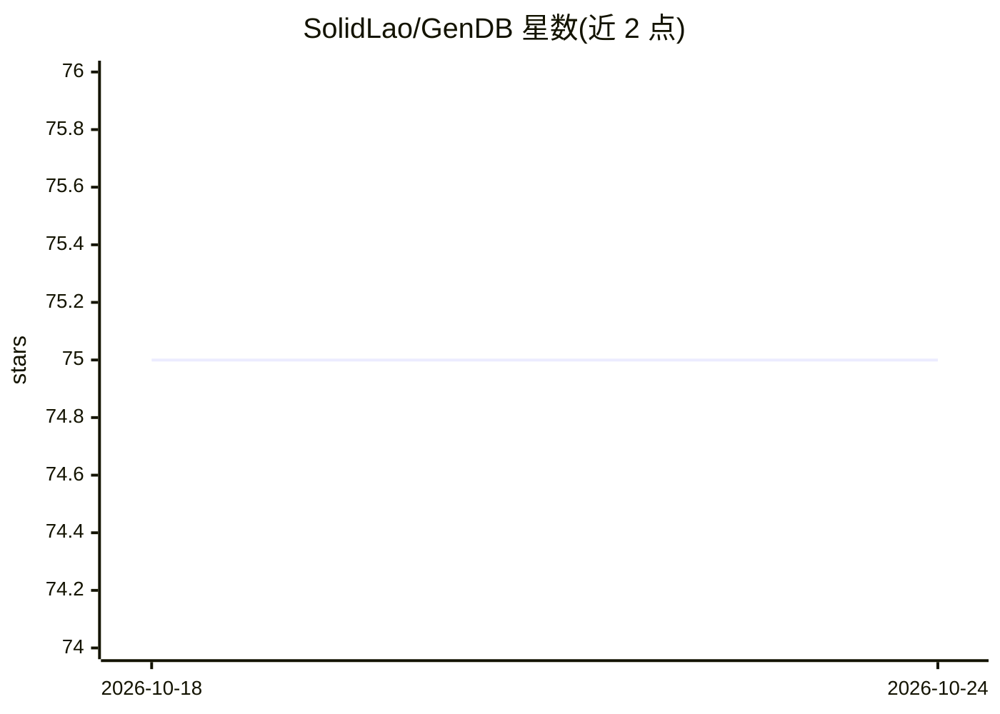

# SolidLao/GenDB

⭐ 75 · C++ · Apache-2.0 · 推送 2026-06-08 · [GitHub](https://github.com/SolidLao/GenDB) · [官网](https://solidlao.github.io/GenDB/) · 组织维护

**用 LLM 多智能体生成实例优化查询执行代码的查询引擎**

面向 OLAP 分析负载的生成式查询引擎：输入数据库 schema、SQL、数据文件与硬件规格，由五个 LLM 智能体（负载分析、存储/索引设计、查询规划、代码生成、迭代优化）协作，产出定制的存储结构、索引与每条查询（模板）一份的独立可执行 C++ 代码。支持 Claude 与 OpenAI Codex 两种 agent provider，在 TPC-H 与 SEC-EDGAR 上与 DuckDB、Umbra 等基准对比。项目处于活跃开发中，论文对应版本在单独分支。

## 筛选速览

| 维度 | 判定 | 备注 |
|---|---|---|
| AI 角色 | `ai-native` | 本体是模型或模型工具 |
| 许可风险 | `permissive` | Apache-2.0 |
| 部署形态 | `None` |  |
| 模型依赖 | locked-api |  |
| 硬件要求 | — | 无带数字的原话,不猜 |
| 安装摩擦 | `high` | 编译与系统依赖俱全 |
| 成熟度 | `idea` | |

## 能力要点

- 五个专职 LLM agent 流水线，输出每查询模板一份的独立原生可执行文件
- SQL 模板级生成与组件复用：相同模板的查询无需重新生成，存储与二进制跨运行持久化并带硬件指纹触发重测
- 自演化记忆系统（实验性，6 层分层抽象图，默认关闭，--memory-dir 启用）
- 支持 Claude（claude-agent-sdk）与 OpenAI Codex（codex-sdk）两种 agent provider，可扩展

## 适用场景

- 为重复执行的固定分析负载生成实例优化代码摊薄生成成本
- 与传统 DBMS 混合部署：传统系统处理临时查询，GenDB 加速高频查询
- 复现 TPC-H / SEC-EDGAR 基准实验结果

## 场景标签

`多智能体` `代码生成` · 领域:Agent 开发

## 证据(README 行号)

> L13: **Input:** database schema, SQL queries, data files, hardware specs, and user configurations (optimization targets,
> L46: GenDB supports multiple LLM agent providers — currently **Claude** (via `@anthropic-ai/claude-agent-sdk`) and **Ope

## 星数曲线

2026-10-18 75 → 2026-10-24 75（+0）

---
*卡片 v1 · prompt 1.4 · 生成 2026-10-24 · 置信度 high · 依据 README sha `ab24114a3dd6` · [字段定义](../../DATASET.md)*
