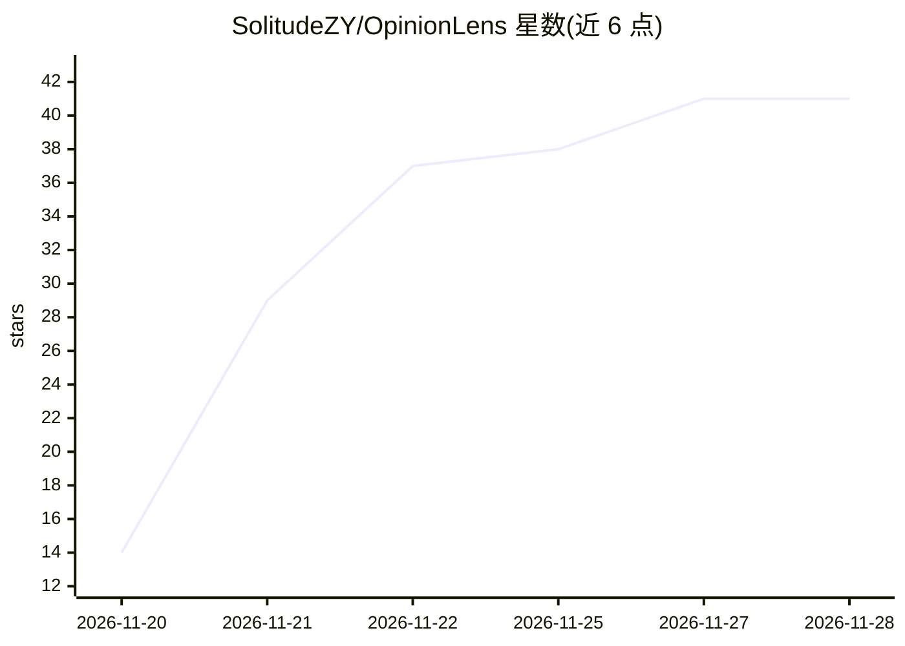

# SolitudeZY/OpinionLens

⭐ 41 · Python · MIT · 推送 2026-11-16 · [GitHub](https://github.com/SolitudeZY/OpinionLens) · 个人维护 · 中文 README

**给个人研究者与中小团队的社媒舆情采集与 AI 报告桌面端**

基于 Electron + FastAPI sidecar 的 Windows 桌面工具，在图形界面内完成扫码登录、按关键词采集 7 个社媒平台的内容与评论、Excel 导出与 AI 舆情报告生成。采集层通过运行时 patch 集成上游 MediaCrawler（仓库不随附其源码，需脚本克隆固定 commit）。AI 叙述由用户自配模型 API 生成，失败或未配置时降级为本地模板报告。数据本地落库 SQLite，仅 Windows 支持；依赖 MediaCrawler 的非商业学习许可，不得商用。

## 筛选速览

| 维度 | 判定 | 备注 |
|---|---|---|
| AI 角色 | `ai-enhanced` | 去掉 AI 部分产品仍成立 |
| 许可风险 | `permissive` | MIT |
| 部署形态 | `desktop` | 安装包/桌面程序 |
| 模型依赖 | local-ok | 支持本地模型 |
| 硬件要求 | — | 无带数字的原话,不猜 |
| 安装摩擦 | `low` | 无编译、无系统依赖或容器化 |
| 成熟度 | — | 结构信号不足 |

## 能力要点

- 覆盖 7 个社媒平台的关键词采集，支持断点续采与数据去重
- AI 报告支持 OpenAI 兼容/DeepSeek/Anthropic 模型 API，可自然语言修订版本
- 多账号号池：独立 Chromium profile、健康度策略与采集失败自动切号
- 本地优先：数据不上传，API Key 经 Windows DPAPI 加密

## 适用场景

- 按关键词监测品牌在各社媒平台的公开讨论并导出 Excel
- 定期生成舆情趋势报告并保留历史版本对比
- 个人学习研究社媒公开内容的采集与分析流程

## 场景标签

`网页抓取` · 领域:效率与自动化

## 证据(README 行号)

> L5: **社媒舆情采集 + AI 报告 · Windows 桌面端**
> L19: 不写代码、不改配置文件，在图形界面里完成「**扫码登录 → 按关键词采集内容与评论 → 导出 Excel → 生成 AI 舆情报告**」的完整闭环。
> L54: |AI 叙述 + 本地渲染|数据包交给用户配置的模型 API 生成叙述，桌面端本地渲染 HTML 报告并落盘|

## 星数曲线

2026-11-20 14 → 2026-11-28 41（+27）

---
*卡片 v1 · prompt 1.4 · 生成 2026-11-20 · 置信度 mid · 依据 README sha `665fcd5588cf` · [字段定义](../../DATASET.md)*
