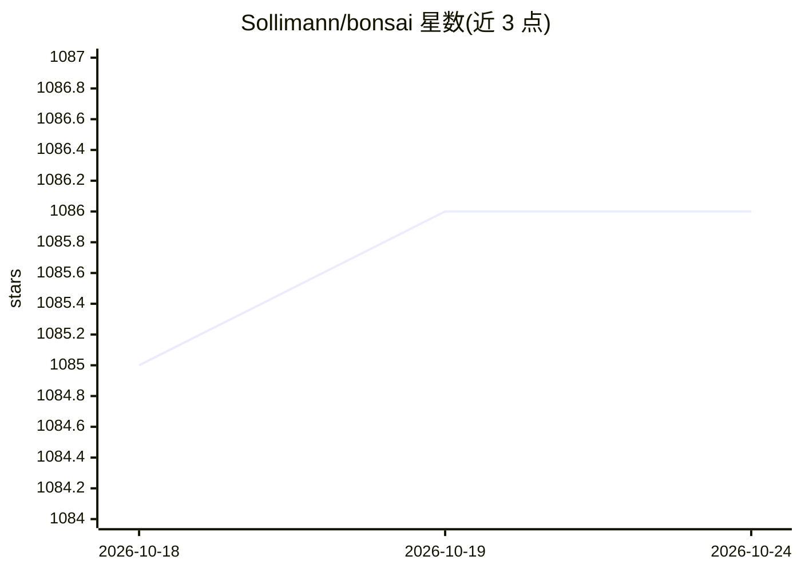

# Sollimann/bonsai

⭐ 1,086 · Rust · MIT · 推送 2026-09-22 · [GitHub](https://github.com/Sollimann/bonsai) · 个人维护

**Rust 行为树库：为游戏与机器人构建模块化确定性 AI**

行为树（Behavior Tree）的 Rust 实现库，提供 Python 绑定并以 bonsai-bt 名称发布到 crates.io 与 PyPI。行为树以树结构组织行为节点，节点间通过 Success/Failure/Running 信号传递控制流。支持 Sequence、Select、If、Invert、Timeout、While、WhenAll、Race 等十余种节点类型，可处理并行与长耗时任务（派发到后台线程并通过 channel 获取状态）。最低要求 rustc 1.72，MIT 许可，附示例目录。

## 筛选速览

| 维度 | 判定 | 备注 |
|---|---|---|
| AI 角色 | `ai-ecosystem` | LLM/agent 周边工具 |
| 许可风险 | `permissive` | MIT |
| 部署形态 | `library` | 以包/库形式分发 |
| 模型依赖 | — | README 未给出锁定关系 |
| 硬件要求 | — | 无带数字的原话,不猜 |
| 安装摩擦 | `low` | 无编译、无系统依赖或容器化 |
| 成熟度 | — | 结构信号不足 |

## 能力要点

- 十余种行为树节点类型（Sequence/Select/Timeout/WhileAll/Race 等）
- Rust crate 与 Python 包（bonsai-bt）双语言分发
- 长耗时任务派发到后台线程，保持树遍历不阻塞
- 支持并行节点 WhenAll/WhenAny/After

## 适用场景

- 为游戏 NPC 编写模块化、可反应的行为逻辑
- 机器人任务规划与状态控制
- 在 Python 项目中复用 Rust 实现的行为树结构

## 场景标签

`Agent 框架` · 领域:Agent 开发

## 证据(README 行号)

> L3:  Rust implementation of Behavior Trees
> L46: A _Behavior Tree_ (BT) is a data structure in which we can set the rules of how certain _behavior's_ can occur, and

## 星数曲线

2026-10-18 1,085 → 2026-10-24 1,086（+1）

---
*卡片 v1 · prompt 1.4 · 生成 2026-10-21 · 置信度 mid · 依据 README sha `1361fa22630b` · [字段定义](../../DATASET.md)*
