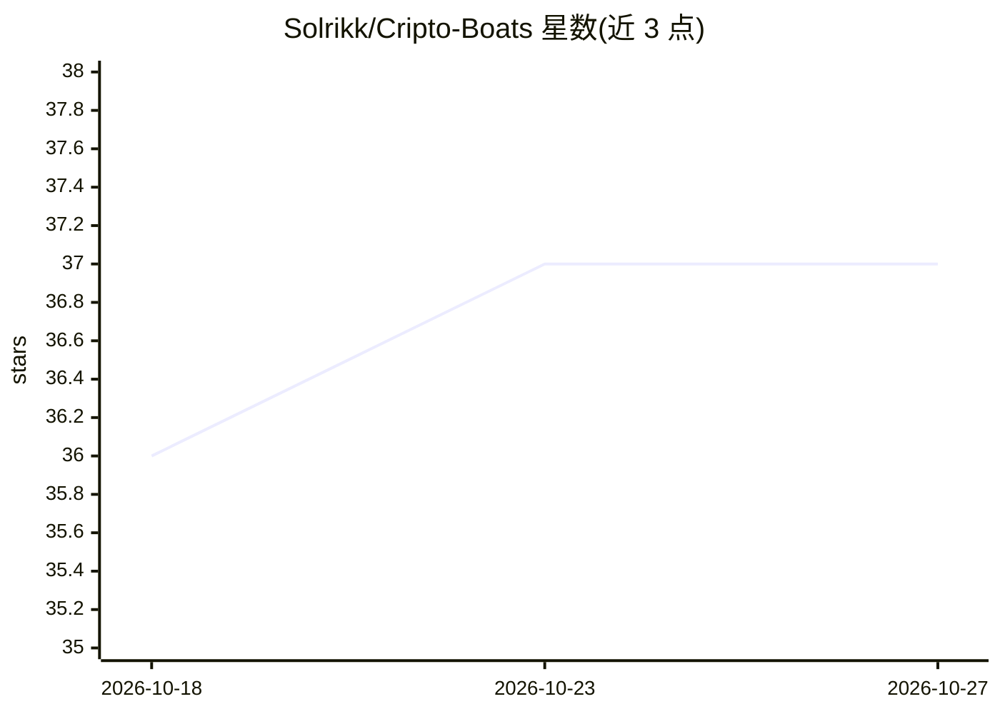

# Solrikk/Cripto-Boats

⭐ 37 · Python · MIT · 推送 2026-10-11 · [GitHub](https://github.com/Solrikk/Cripto-Boats) · 个人维护

**半自动加密货币合约交易机器人：LSTM+随机森林生成交易信号**

面向个人交易者的加密货币合约交易系统，强调手动控制关键决策（止盈/止损手动设定），同时可多资产开仓分散风险。AI 部分采用 LSTM（2 层双向，输入 60 时间步×18 特征，输出买卖二分类）与 Random Forest（100 棵树，SMOTE 类平衡）结合 RSI/EMA/MACD 等技术指标生成进出场信号，接入 Bybit API 执行。README 声明仍处实验/Beta 阶段，含投资风险免责条款。通过 git clone 源码安装，需自配 Bybit API 密钥。

## 筛选速览

| 维度 | 判定 | 备注 |
|---|---|---|
| AI 角色 | `ai-native` | 本体是模型或模型工具 |
| 许可风险 | `permissive` | MIT |
| 部署形态 | `library` | 以包/库形式分发 |
| 模型依赖 | — | README 未给出锁定关系 |
| 硬件要求 | — | 无带数字的原话,不猜 |
| 安装摩擦 | `low` | 无编译、无系统依赖或容器化 |
| 成熟度 | `idea` | |

## 能力要点

- LSTM（双向 2 层）与 Random Forest（100 树）双模型生成买卖信号
- 18 个特征×60 时间步输入，含 RSI/MACD/Ichimoku/VWAP 等技术指标
- 半自动模式：手动控制止盈止损，支持多仓位分散
- 接入 Bybit API，每笔风险上限 0.3%、60 秒交易冷却

## 适用场景

- 在 Bybit 合约市场运行信号辅助的半自动交易
- 多资产同时持仓以分散风险
- 结合技术指标与 ML 模型生成进出场决策

## 场景标签

`金融量化` · 领域:学习与行业

## 证据(README 行号)

> L40: 1. **LSTM (Long Short-Term Memory)**
> L79:  - LSTM Network: 2-layer bidirectional architecture

## 星数曲线

2026-10-18 36 → 2026-10-27 37（+1）

---
*卡片 v1 · prompt 1.4 · 生成 2026-10-25 · 置信度 mid · 依据 README sha `e6e63208b8a1` · [字段定义](../../DATASET.md)*
