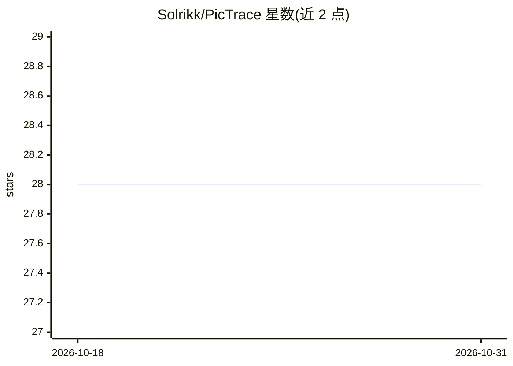

# Solrikk/PicTrace

⭐ 28 · Python · Apache-2.0 · 推送 2026-06-28 · [GitHub](https://github.com/Solrikk/PicTrace) · [官网](https://tapeflow.ru/) · 个人维护

**上传图片后在照片档案中查找视觉相似图片的 Python Web 应用**

基于 Python 的图像相似检索应用：用户上传图片后，系统将图像与数据库图片统一缩放为 256x256 并转灰度，用 SSIM 结构相似度与 ORB 关键点匹配两种方法计算相似度得分；同时以 TensorFlow/Keras 加载 ResNet50 预训练模型提取图像特征，配合 OpenCV、Pillow、scikit-image、pickle 等库完成处理与特征缓存。界面提供 Tkinter GUI，README 标注 FastAPI。适用于对大量图片集进行编目、整理与分析的场景。通过 git clone 源码配合 Poetry 安装运行，提供在线 Demo。

## 筛选速览

| 维度 | 判定 | 备注 |
|---|---|---|
| AI 角色 | `ai-native` | 本体是模型或模型工具 |
| 许可风险 | `permissive` | Apache-2.0 |
| 部署形态 | `library` | 以包/库形式分发 |
| 模型依赖 | — | README 未给出锁定关系 |
| 硬件要求 | — | 无带数字的原话,不猜 |
| 安装摩擦 | `low` | 无编译、无系统依赖或容器化 |
| 成熟度 | — | 结构信号不足 |

## 能力要点

- SSIM + ORB 双方法计算图像相似度
- ResNet50 预训练模型（ImageNet 权重）提取图像特征
- pickle 序列化保存预计算特征、hashlib 生成图片唯一哈希
- 支持 ZIP 压缩包形式的图片集管理

## 适用场景

- 上传一张图片在照片档案中找相似图
- 对大型图片集进行编目与整理时做去重比对
- 分析含噪声/变形复杂图片间的共同特征

## 场景标签

`图像视频处理` `语义搜索` · 领域:知识与检索

## 证据(README 行号)

> L19: ✨ **PicTrace** is an advanced **Python-based** web application that allows users to find **visually similar images*
> L44:  - **TensorFlow and Keras**: Utilized for loading the ResNet50 model and extracting features from images, ensuring 
> L102: PicTrace uses both **SSIM** and **ORB** methods to find images that are similar to an uploaded image. Here's a sim

## 星数曲线

2026-10-18 28 → 2026-10-31 28（+0）

---
*卡片 v1 · prompt 1.4 · 生成 2026-10-26 · 置信度 mid · 依据 README sha `3f48f3b606f4` · [字段定义](../../DATASET.md)*
