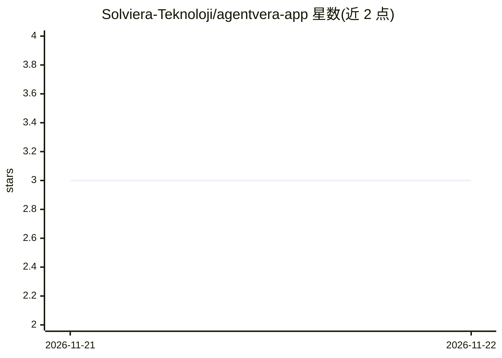

# Solviera-Teknoloji/agentvera-app

⭐ 3 · 推送 2026-11-03 · [GitHub](https://github.com/Solviera-Teknoloji/agentvera-app) · [官网](https://agentvera.dev/en/) · 组织维护

**在单窗口并行运行多个 AI 编码 agent 的桌面应用**

AgentVera 是闭源桌面应用（本仓库为其发布、issue 与功能请求主页），在真实终端中并列运行用户已安装并登录的编码 agent CLI，按项目组织为 1×1 至 5×4 网格。它不生成代码本身，而是提供 agent 之间的管理层：每 agent 独立 git worktree、flows 管道、agent 团队（管理者/成员角色分工）、代码审查、账号切换与用量成本统计、1,036 条技能目录、手机远程控制。核心功能免费，Pro/Team 订阅解锁 flows、夜班、自动审批等；独立开源部分为 MIT 许可的 agentvera-board MCP 服务器。

## 筛选速览

| 维度 | 判定 | 备注 |
|---|---|---|
| AI 角色 | `ai-ecosystem` | LLM/agent 周边工具 |
| 许可风险 | `none` | — |
| 部署形态 | `desktop` | 安装包/桌面程序 |
| 模型依赖 | — | README 未给出锁定关系 |
| 硬件要求 | — | 无带数字的原话,不猜 |
| 安装摩擦 | `low` | 无编译、无系统依赖或容器化 |
| 成熟度 | — | 结构信号不足 |

## 能力要点

- 并行运行 Claude Code、Codex、Gemini CLI、Copilot 等 18 个 agent CLI，无需 API key，使用用户自有订阅
- 每 agent 独立 git worktree，冲突文件编辑告警，diff 审查后合并
- agent 团队机制：指定管理者拆分任务并按角色接力，支持夜班队列与草稿 PR
- 附带 MIT 许可的 agentvera-board MCP 服务器，可脱离本应用独立使用

## 适用场景

- 同时开多个编码 agent 处理同一项目的不同任务
- 用 agent 团队把一个大需求拆成研究、计划、开发、审查流水线
- 按用量限额自动切换 Claude/ChatGPT 账号并追踪成本

## 场景标签

`编码 Agent` `多智能体` · 领域:Agent 开发

## 证据(README 行号)

> L13: AgentVera is a desktop app that runs the coding agents already installed on your computer in real terminals, side b
> L15: This repository is AgentVera's public home: **releases, issues and feature requests**. The app itself is closed sou
> L100: The app updates itself. Core features are free with unlimited agents; Pro and Team plans add flows, the pipeline, 

## 星数曲线

2026-11-21 3 → 2026-11-22 3（+0）

---
*卡片 v1 · prompt 1.4 · 生成 2026-11-22 · 置信度 mid · 依据 README sha `bd0e5776eb65` · [字段定义](../../DATASET.md)*
