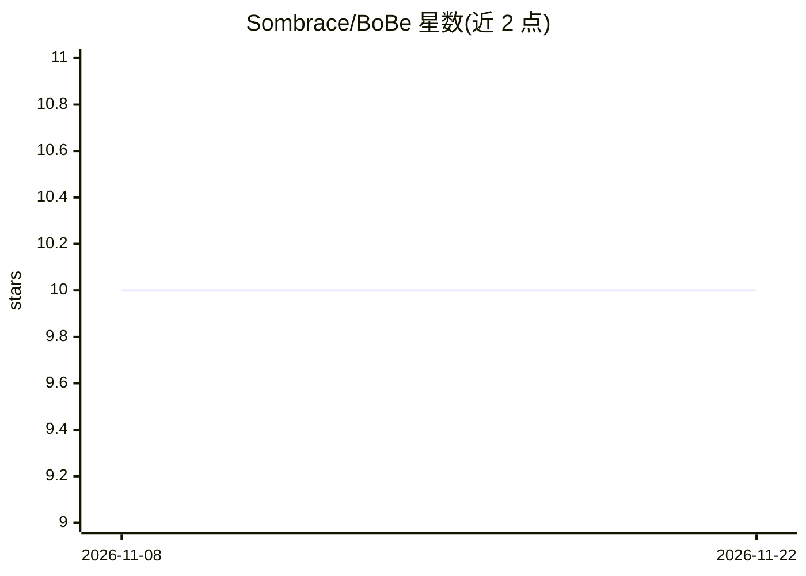

# Sombrace/BoBe

⭐ 10 · Rust · MIT · 推送 2026-11-17 · [GitHub](https://github.com/Sombrace/BoBe) · [官网](https://www.bobebot.com) · 个人维护

**macOS 本地优先的主动式 AI 桌面伴侣**

BoBe 是常驻 Mac 桌面的 AI 伴侣应用：以小脸形象驻留桌面，读取屏幕内容感知用户工作，维护一份可编辑的记忆文档与 Markdown 格式的目标文件并按小时推进，支持安静/平衡/主动三种打断策略。可打字或语音交互，通过文件、shell、Git、MCP 服务器等工具执行实际操作。数据存于本机 ~/.bobe/，守护进程仅监听 127.0.0.1。支持 OpenAI、Anthropic、DeepSeek、OpenRouter、GitHub Copilot 等云端模型或经 Ollama 使用本地模型；另支持 headless 运行、iPhone 客户端与 ESP32 原型设备。

## 筛选速览

| 维度 | 判定 | 备注 |
|---|---|---|
| AI 角色 | `ai-native` | 本体是模型或模型工具 |
| 许可风险 | `permissive` | MIT |
| 部署形态 | `desktop` | 安装包/桌面程序 |
| 模型依赖 | local-ok | 支持本地模型 |
| 硬件要求 | — | 无带数字的原话,不猜 |
| 安装摩擦 | `low` | 无编译、无系统依赖或容器化 |
| 成熟度 | — | 结构信号不足 |

## 能力要点

- 读取屏幕文本感知工作内容，画面不离开本机
- 单一份可读可编辑的记忆文档与 Markdown 目标文件
- 语音对话在本地硬件上处理，不存储原始音频
- 支持 MCP 服务器、技能与辅助 agent 等工具

## 适用场景

- 在 Mac 上拥有一个会主动提醒和推进目标的助手
- 让 AI 通过 shell 和 Git 直接完成文件层面的工作
- 全程本地保存数据、按需切换云端或本地模型

## 场景标签

`AI 助手` · 领域:对话与助手

## 证据(README 行号)

> L22: BoBe is a companion who lives on your Mac. BoBe sits on your desktop as a small
> L28: runs where you choose: OpenAI, Anthropic, DeepSeek, OpenRouter,
> L45: ESP32 body (a prototype).

## 星数曲线

2026-11-08 10 → 2026-11-22 10（+0）

---
*卡片 v1 · prompt 1.4 · 生成 2026-11-20 · 置信度 high · 依据 README sha `50d45fdfe007` · [字段定义](../../DATASET.md)*
