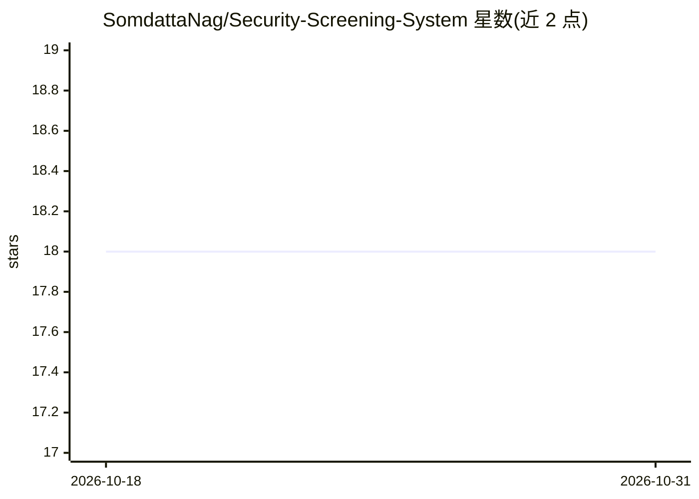

# SomdattaNag/Security-Screening-System

⭐ 18 · Python · AGPL-3.0 · 推送 2026-10-30 · [GitHub](https://github.com/SomdattaNag/Security-Screening-System) · 个人维护

**基于人脸识别的实时安防筛查系统（原型）**

面向机场、酒店、活动场馆等安检场景的 Python 实时人脸识别原型：用 OpenCV 与 face_recognition 库对 webcam 画面提取人脸并与在库人员（通缉/禁入名单）编码比对，默认 0.4 人脸距离阈值（可经 GUI 调整），约 10 秒确认身份，30 秒内避免重复告警。命中后触发分级告警（邮件/SMS，>90% 置信度触发电话）并保存记录到 CSV；另含 YOLOv5 配件检测模块，检测到口罩/墨镜/帽子时暂停识别并 GUI 提示。README 声明这是工作原型，许可以 AGPL-3.0 为主（另有一处 MIT 声明）。

## 筛选速览

| 维度 | 判定 | 备注 |
|---|---|---|
| AI 角色 | `ai-native` | 本体是模型或模型工具 |
| 许可风险 | `viral` | AGPL-3.0 |
| 部署形态 | `library` | 以包/库形式分发 |
| 模型依赖 | — | README 未给出锁定关系 |
| 硬件要求 | — | 无带数字的原话,不猜 |
| 安装摩擦 | `low` | 无编译、无系统依赖或容器化 |
| 成熟度 | `idea` | |

## 能力要点

- 实时人脸比对：0.4 人脸距离/60% 置信度默认阈值，GUI 可调
- YOLOv5 配件检测模块（口罩/墨镜/帽子）暂停识别并 GUI 警告
- 分级威胁告警：邮件/SMS，>90% 置信度追加电话告警
- 命中记录保存 CSV；非匹配个体不存储数据

## 适用场景

- 在出入口用摄像头对人员做实时身份筛查与威胁告警
- 为安防原型或课程/开源贡献项目（GSSoC）学习人脸识别流程
- 按名单核验通缉/禁入人员并留存取证记录

## 场景标签

`人脸识别` `网络安全` · 领域:学习与行业

## 证据(README 行号)

> L60: We are creating a smart security system that uses facial recognition with the help of OpenCV. This system will work
> L78: 1. The system uses a webcam to scan each person and detect their face.

## 星数曲线

2026-10-18 18 → 2026-10-31 18（+0）

---
*卡片 v1 · prompt 1.4 · 生成 2026-10-29 · 置信度 high · 依据 README sha `b6beaab809e5` · [字段定义](../../DATASET.md)*
