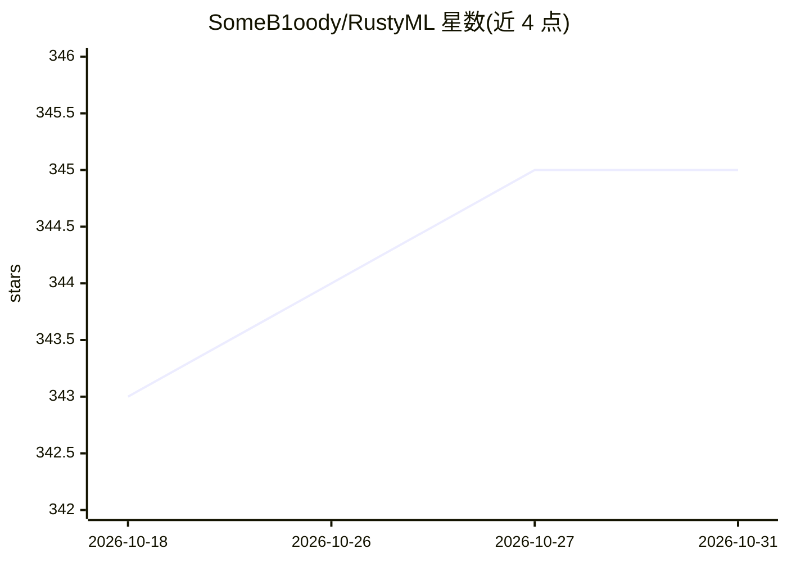

# SomeB1oody/RustyML

⭐ 345 · Rust · MIT · 推送 2026-10-27 · [GitHub](https://github.com/SomeB1oody/RustyML) · 个人维护 · 中文 README

**纯 Rust 编写的机器学习与深度学习库**

以纯 Rust 实现、无 C/C++ FFI 依赖的机器学习与深度学习库，覆盖数据预处理、特征工程、模型训练与评估全流程。提供经典监督/无监督算法、异常检测、带序列模型与图模型的神经网络框架，重计算内核默认用 Rayon 多线程并行。支持 set_global_seed 可复现训练、模型二进制持久化（Serde + postcard），评估指标遵循 scikit-learn 惯例。通过 feature flags 模块化编译，MSRV 为 Rust 1.89+。处于 1.0.0 前的活跃开发期，次版本可能出现破坏性变更。

## 筛选速览

| 维度 | 判定 | 备注 |
|---|---|---|
| AI 角色 | `ai-native` | 本体是模型或模型工具 |
| 许可风险 | `permissive` | MIT |
| 部署形态 | `library` | 以包/库形式分发 |
| 模型依赖 | — | README 未给出锁定关系 |
| 硬件要求 | — | 无带数字的原话,不猜 |
| 安装摩擦 | `low` | 无编译、无系统依赖或容器化 |
| 成熟度 | `idea` | |

## 能力要点

- 纯 Rust 实现、无 C/C++ FFI 依赖
- Rayon 多线程并行计算，默认开启
- 神经网络框架含序列模型与图模型（多入多出、残差连接、分支合并）
- 模型与网络权重的二进制持久化（Serde + postcard）

## 适用场景

- 在 Rust 项目中做数据预处理、训练与评估经典 ML 模型
- 构建序列或图结构的神经网络（含残差连接与分支合并）
- 需要内存安全且无外部链接依赖的可移植 ML 方案

## 场景标签

 · 领域:机器学习/开发库

## 证据(README 行号)

> L17: RustyML is a machine learning and deep learning library, built end to end in Rust with no C or
> L26: - **Algorithm coverage**: classical supervised and unsupervised learning, anomaly detection, and a neural-network f

## 星数曲线

2026-10-18 343 → 2026-10-31 345（+2）

---
*卡片 v1 · prompt 1.4 · 生成 2026-10-21 · 置信度 high · 依据 README sha `3dec7ef155cd` · [字段定义](../../DATASET.md)*
