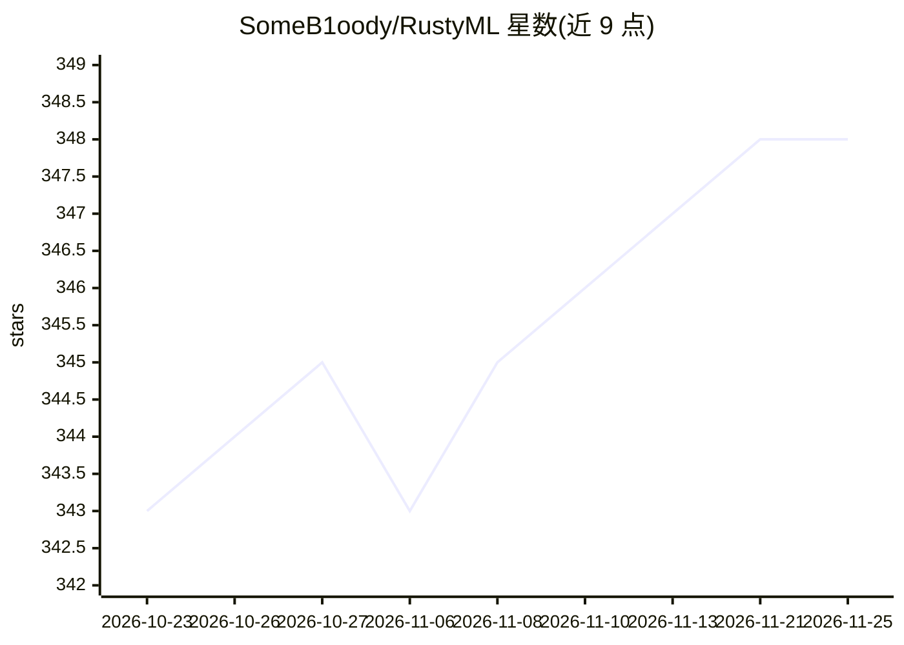

# SomeB1oody/RustyML

⭐ 348 · Rust · MIT · 推送 2026-10-27 · [GitHub](https://github.com/SomeB1oody/RustyML) · 个人维护 · 中文 README

**纯 Rust 编写的机器学习与神经网络库，供开发者建模用**

纯 Rust 实现的机器学习与深度学习库，以 crates.io crate 发布，依赖 ndarray 数组并提供五类模块：经典机器学习（分类/回归/聚类/分解/异常检测）、神经网络（层、优化器、损失、checkpoint）、数据预处理、评估指标与数值原语。部分内核经 Rayon 并行化，可通过 feature flag 按模块编译；模型可经 Serde 保存加载，网络支持多输入多输出、共享层与残差连接。MSRV 为 Rust 1.89+，1.0.0 前 API 可能随小版本变更。

## 筛选速览

| 维度 | 判定 | 备注 |
|---|---|---|
| AI 角色 | `ai-native` | 本体是模型或模型工具 |
| 许可风险 | `permissive` | MIT |
| 部署形态 | `library` | 以包/库形式分发 |
| 模型依赖 | — | README 未给出锁定关系 |
| 硬件要求 | — | 无带数字的原话,不猜 |
| 安装摩擦 | `low` | 无编译、无系统依赖或容器化 |
| 成熟度 | `idea` | |

## 能力要点

- 监督/无监督/异常检测等经典 ML 模型与神经网络框架
- Rayon 并行内核与串行/并行路径的工作阈值控制
- 模型经 Serde+postcard 保存加载，网络支持 checkpoint
- feature flag 按模块裁剪编译，MIT 许可

## 适用场景

- 在 Rust 项目中做分类、回归、聚类建模
- 训练并保存神经网络，之后加载 checkpoint 推理
- 对模型输出计算分类/回归/聚类评估指标
- 对数据做预处理、缩放与数据集划分

## 场景标签

`模型训练` · 领域:训练与推理

## 证据(README 行号)

> L5: A machine learning and deep learning library written in **pure Rust**.
> L17: RustyML provides data preprocessing, machine learning models, neural networks, and evaluation metrics.
> L23: - **Models**: supervised learning, unsupervised learning, anomaly detection, sequential networks, and graph network

## 星数曲线

2026-10-23 343 → 2026-11-25 348（+5）

---
*卡片 v1 · prompt 1.4 · 生成 2026-11-25 · 置信度 high · 依据 README sha `2084f4a768b0` · [字段定义](../../DATASET.md)*
