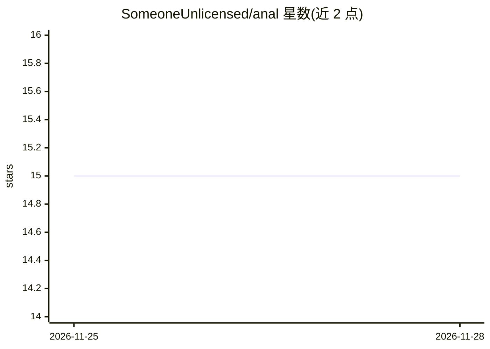

# SomeoneUnlicensed/anal

⭐ 15 · Go · MIT · 推送 2026-11-23 · [GitHub](https://github.com/SomeoneUnlicensed/anal) · [官网](https://pkg.go.dev/github.com/SomeoneUnlicensed/anal) · 个人维护

**面向 agent 数据流的省 token 序列化格式与 Go 库**

ANAL 是一种紧凑的序列化格式，用于 agent 与模型之间传输的数据：字段名在表头声明一次，随后每行仅发送值，通过匹配 tokenizer 而非重训模型来减少 token 数。提供 Go 库（Marshal/Unmarshal，兼容 json struct tags）、CLI 编解码与 Python 辅助脚本（转换、token 节省 diff、工具结果包装）。支持三种数据块类型与嵌套数据的扁平化编解码，附基准测试脚本与数据。

## 筛选速览

| 维度 | 判定 | 备注 |
|---|---|---|
| AI 角色 | `ai-ecosystem` | LLM/agent 周边工具 |
| 许可风险 | `permissive` | MIT |
| 部署形态 | `library` | 以包/库形式分发 |
| 模型依赖 | — | README 未给出锁定关系 |
| 硬件要求 | — | 无带数字的原话,不猜 |
| 安装摩擦 | `low` | 无编译、无系统依赖或容器化 |
| 成熟度 | — | 结构信号不足 |

## 能力要点

- @table/@obj/@list 三种结构，字段名只声明一次
- Marshal/Unmarshal 与 encoding/json 同类值兼容，任意 JSON 值可编码
- CLI 可将 skill 安装到 Codex 与 Claude Code
- 提供 Python 工具测量相对 JSON 的 token 节省

## 适用场景

- 在 agent 工具结果与上下文间传输大表数据以减少 token 计费
- Go 服务中替代 JSON 编解码结构化数据
- 复现并对比 JSON/TOON/ANAL 的 token 消耗

## 场景标签

 · 领域:LLM 基础设施/数据格式

## 证据(README 行号)

> L8: ANAL (Agent Notation, Actually Lean) is a compact, token-lean serialization
> L9: format for data flowing between agents and models. It needs no model
> L96: Install the ANAL skill so coding agents know to compress large structured data:

## 星数曲线

2026-11-25 15 → 2026-11-28 15（+0）

---
*卡片 v1 · prompt 1.4 · 生成 2026-11-25 · 置信度 mid · 依据 README sha `008b3ed0a3e9` · [字段定义](../../DATASET.md)*
