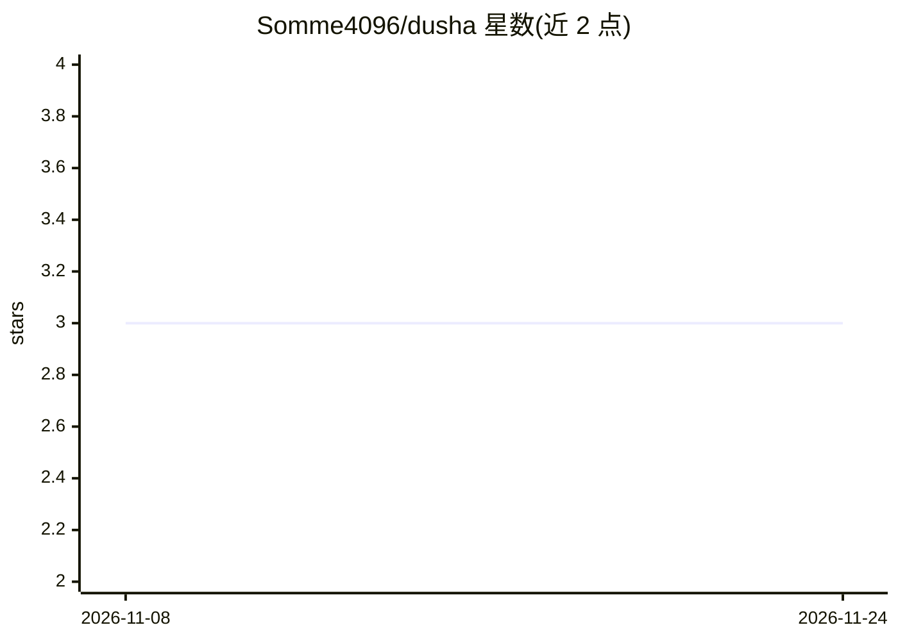

# Somme4096/dusha

⭐ 3 · Python · Apache-2.0 · 推送 2026-11-21 · [GitHub](https://github.com/Somme4096/dusha) · [官网](https://pypi.org/project/dusha/) · 个人维护

**AI 伴侣的记忆与上下文注入 API/代理**

Dusha 是一个轻量 Python API，为 AI 伴侣类应用提供三层能力：存储消息、记忆、情感状态等上下文；在每次 LLM 调用时注入这些上下文；并提供可扩展的 MCP 与 CLI 供添加工具。请求经 dusha 代理路由到上游模型，消息上下文后置以命中缓存。内置 SQLite FTS5 加可选嵌入检索的长期记忆、确定性情感引擎与身份管理，全组件以插件形式实现可替换。通过 PyPI 安装或 Docker/Podman 部署，任意 provider 均可接入。

## 筛选速览

| 维度 | 判定 | 备注 |
|---|---|---|
| AI 角色 | `ai-ecosystem` | LLM/agent 周边工具 |
| 许可风险 | `permissive` | Apache-2.0 |
| 部署形态 | `self-host` | docker 或自建部署 |
| 模型依赖 | — | README 未给出锁定关系 |
| 硬件要求 | — | 无带数字的原话,不猜 |
| 安装摩擦 | `low` | 无编译、无系统依赖或容器化 |
| 成熟度 | — | 结构信号不足 |

## 能力要点

- 每次 LLM 调用前注入消息/记忆/情感/身份上下文
- 确定性情感引擎，数值随时间与用户响应状态变化
- 全插件化架构：身份、记忆、情感等内置组件可替换或禁用
- 代理模式下后置注入上下文以命中缓存，任意 provider 可接入

## 适用场景

- 为 AI 伴侣应用添加跨会话的记忆与情感状态
- 在不同 harness 间复用同一个伴侣的上下文
- 通过 MCP 为伴侣添加实时数据（如天气 API）等工具

## 场景标签

`Agent 记忆` · 领域:Agent 开发

## 证据(README 行号)

> L13: **Dusha** (_Rus:_ душа, [dʊˈʂa], "soul") is a lightweight python API that:
> L16: 2) injects those contexts at every LLM call (any provider is supported)
> L17: 3) has an extensible MCP and CLI to let you add any tools.

## 星数曲线

2026-11-08 3 → 2026-11-24 3（+0）

---
*卡片 v1 · prompt 1.4 · 生成 2026-11-22 · 置信度 high · 依据 README sha `4e4b07353e6b` · [字段定义](../../DATASET.md)*
