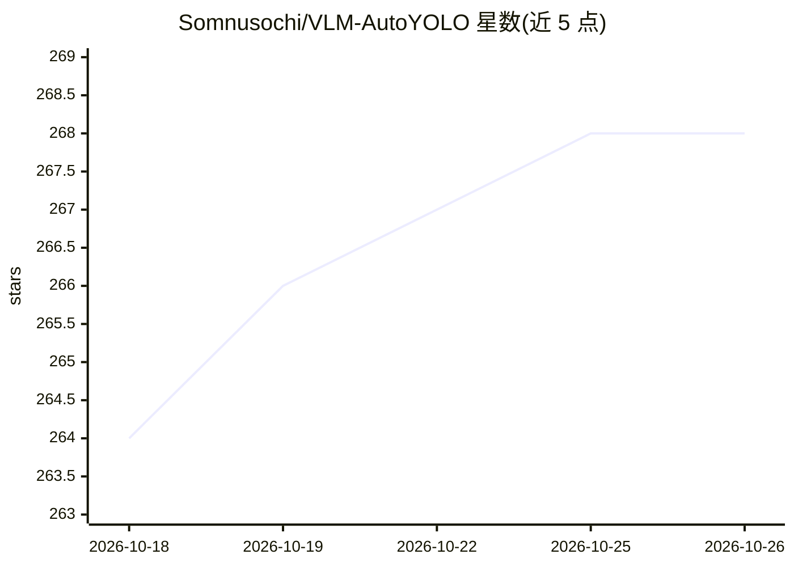

# Somnusochi/VLM-AutoYOLO

⭐ 268 · Python · AGPL-3.0 · 推送 2026-09-22 · [GitHub](https://github.com/Somnusochi/VLM-AutoYOLO) · 个人维护 · 中文 README

**VLM 自动标注与 YOLO 训练一体化平台**

面向目标检测数据准备的端到端 Web 平台：上传图片或视频，用 NVIDIA LocateAnything-3B 开放词汇检测做 VLM 预标注，SAM2.1/SAM3 将框精化为像素级掩码，支持画布人工修正，导出 YOLO/YOLO-Seg/COCO/VOC/CreateML 五种格式，并可一键训练 YOLOv8/v11/v26（检测与分割）、批量验证模型。后端 FastAPI+PostgreSQL，前端 React；GPU 加速支持 macOS MPS 与 NVIDIA CUDA，不支持纯 CPU。提供 CLI、Docker 与手动三种部署方式。

## 筛选速览

| 维度 | 判定 | 备注 |
|---|---|---|
| AI 角色 | `ai-native` | 本体是模型或模型工具 |
| 许可风险 | `viral` | AGPL-3.0 |
| 部署形态 | `self-host` | docker 或自建部署 |
| 模型依赖 | — | README 未给出锁定关系 |
| 硬件要求 | `gpu-8g` | |
| 安装摩擦 | `low` | 无编译、无系统依赖或容器化 |
| 成熟度 | — | 结构信号不足 |

## 能力要点

- LocateAnything-3B 开放词汇 VLM 自动标注
- SAM2.1/SAM3 框到像素级掩码精化与人工修正
- 五格式导出与一键 YOLO 训练（检测/分割，SSE 实时进度）
- 视频关键帧提取（场景/运动/间隔三种模式）与批量模型验证

## 适用场景

- 为自建数据集做目标检测自动标注并人工修正
- 从标注到 YOLO 模型训练与验证的一站式流水线
- 从视频中提取关键帧并批量标注

## 场景标签

`目标检测` `模型训练` `图像视频处理` · 领域:感知与多模态

## 证据(README 行号)

> L17: **Images or videos in → YOLO model out**, with VLM auto-labeling (LocateAnything-3B), SAM2.1 / SAM3 mask refinement
> L26: - 🤖 **VLM auto-labeling**: Open-vocabulary object detection with LocateAnything-3B

## 星数曲线

2026-10-18 264 → 2026-10-26 268（+4）

---
*卡片 v1 · prompt 1.4 · 生成 2026-10-22 · 置信度 mid · 依据 README sha `766a3ecc888a` · [字段定义](../../DATASET.md)*
