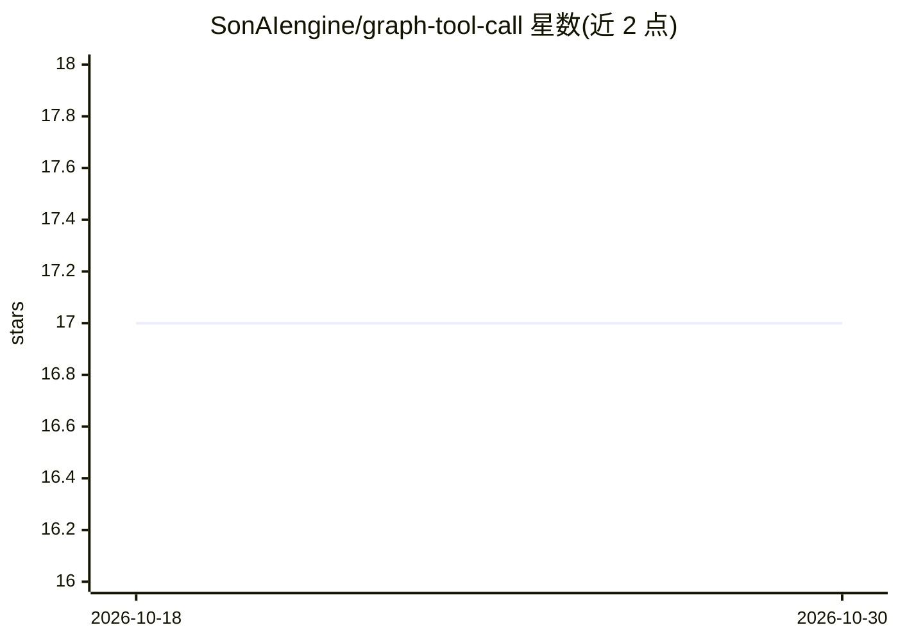

# SonAIengine/graph-tool-call

⭐ 17 · Python · MIT · 推送 2026-10-08 · [GitHub](https://github.com/SonAIengine/graph-tool-call) · [官网](https://pypi.org/project/graph-tool-call/) · 组织维护

**LLM agent 大工具目录的图结构检索与 schema 精简层**

面向 agent 框架的工具检索引擎：从 OpenAPI、GraphQL 内省、MCP 工具、Python 函数等来源确定性摄取工具目录，构建合同感知的图，用关键词、图、可选嵌入与 MCP 标注信号做混合目标检索，做带证据的目标选择与类型化前置工具展开，并按 token 预算输出精简 schema 目录。核心包仅用 Python 标准库，零核心依赖；提供 OpenAI、Anthropic、LangChain v1、MCP server/proxy、Docker/Kubernetes 适配。认证、租户策略与执行留在宿主应用。基准为引擎回归套件，非总体精度估计。

## 筛选速览

| 维度 | 判定 | 备注 |
|---|---|---|
| AI 角色 | `ai-ecosystem` | LLM/agent 周边工具 |
| 许可风险 | `permissive` | MIT |
| 部署形态 | `library` | 以包/库形式分发 |
| 模型依赖 | locked-api |  |
| 硬件要求 | — | 无带数字的原话,不猜 |
| 安装摩擦 | `low` | 无编译、无系统依赖或容器化 |
| 成熟度 | — | 结构信号不足 |

## 能力要点

- 从 OpenAPI/GraphQL/MCP/Python 函数多源摄取并保留类型化 consumes/produces 合同
- 混合目标检索（关键词+图+可选嵌入+MCP 标注）与带证据的确定性目标选择
- token 预算内输出合同投影 schema，减少发给模型的 schema 体积
- OpenAI/Anthropic/LangChain v1 patch 与 MCP server/proxy、Docker/K8s 部署适配

## 适用场景

- agent 接数百个工具时按请求筛选并发送最小 schema 集合
- 查找目标工具及其前置生产工具以补齐缺失参数
- 为 Claude Code/Cursor 等 MCP 客户端做统一工具网关

## 场景标签

`Agent 框架` `语义搜索` · 领域:Agent 开发

## 证据(README 行号)

> L32: context and can lower selection quality. graph-tool-call treats retrieval as a
> L44: - adapters for OpenAI, Anthropic, LangChain v1, MCP, Docker, and Kubernetes.

## 星数曲线

2026-10-18 17 → 2026-10-30 17（+0）

---
*卡片 v1 · prompt 1.4 · 生成 2026-10-29 · 置信度 high · 依据 README sha `1c970eae651f` · [字段定义](../../DATASET.md)*
